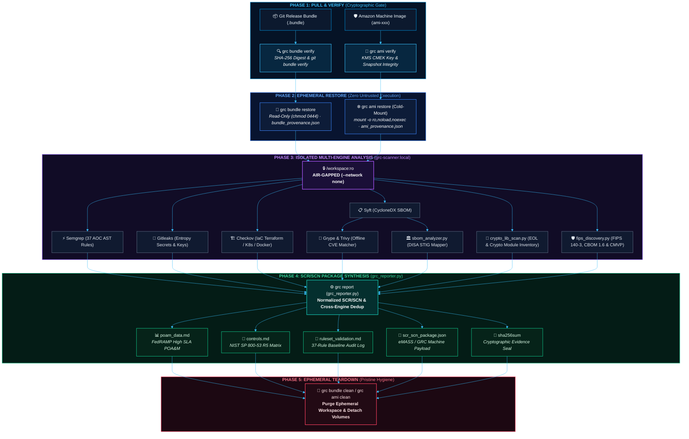

# GRC-xMINI — The GRC eXperience (`grc`)

<p align="center">
  <picture>
    <source media="(prefers-color-scheme: dark)" srcset="assets/logo/grcx-logo-dark.png">
    <source media="(prefers-color-scheme: light)" srcset="assets/logo/grcx-logo-light.png">
    
  </picture>
</p>

<p align="center">
  <a href="README.md"><b>📖 README</b></a> &nbsp;·&nbsp;
  <a href="INSTALL.md"><b>⚙️ Install Guide</b></a> &nbsp;·&nbsp;
  <a href="COMMANDS.md"><b>⌨️ CLI Commands</b></a> &nbsp;·&nbsp;
  <a href="amplifying-info/ARCHITECTURE.md"><b>🏛️ Architecture & Tech Stack</b></a> &nbsp;·&nbsp;
  <a href="amplifying-info/DATAFLOW.md"><b>🔄 Data Flow</b></a> &nbsp;·&nbsp;
  <a href="SECURITY.md"><b>🛡️ Security Policy</b></a> &nbsp;·&nbsp;
  <a href="amplifying-info/GOVERNANCE.md"><b>⚖️ Governance & Mandates</b></a> &nbsp;·&nbsp;
  <a href="testing/TESTING.md"><b>🧪 Verification Plan</b></a> &nbsp;·&nbsp;
  <a href="testing/live-demo.md"><b>🎬 Live Demo</b></a> &nbsp;·&nbsp;
  <a href="hygiene/RELEASE_NOTES.md"><b>🚀 Release Notes</b></a> &nbsp;·&nbsp;
  <a href="hygiene/PATCH_LOG.md"><b>🩹 Patch Log Index</b></a> &nbsp;·&nbsp;
  <a href="hygiene/ROADMAP.md"><b>🗺️ Roadmap</b></a> &nbsp;·&nbsp;
  <a href="hygiene/RELEASING.md"><b>🏷️ Releasing</b></a> &nbsp;·&nbsp;
  <a href="docs/transform_scans-guide.md"><b>📊 Scan-to-POA&M Guide</b></a> &nbsp;·&nbsp;
  <a href="docs/grc_bundle-guide.md"><b>📑 Bundle Walkthrough</b></a> &nbsp;·&nbsp;
  <a href="docs/grc-xtest-guide.md"><b>🎯 GRC-xTEST Guide</b></a>
</p>

```text
> ./grc fetch
        .--.          .--.          .--.                       
  ,p#G*""TG#Gp, ,p#G*""TG#Gp, ,p#G*""TG#Gp,                  GRC-xMINI v1.5.3 (Iwakuni Series)
 {GGG'     `G# {GGG     `GGG {GGG'     `G#                   --------------------------------
 @GGG          @GGG     ,GGG @GGG          ,p#Gp,   ,p#Gp,   OS: Darwin ARM64 / Linux Bookworm
 'GGG   ,p#GG# @GGG#**#GGG"  'GGG           `GGG, ,GGG'      Model: Out-of-Band (OOB) / Fail-Open
  GGG   ""`GGG @GGG   `GGG,   GGG             `GGGGG'        Assurance: Pure Python Stdlib (Host-Native)
 ]GGG#     GGG @GGG    ]GGG  ]GGG#     ,G#    ,GGGGG,        Companion: GRC-xTEST & GRC-xBOT (v1.5.x+ Synced)
  @GGGb,,,dGGG @GGG     GGG,  @GGGb,,,dGG"  ,GGG' `GGG,      Frameworks: DISA STIG, NIST 800-53 R5, FedRAMP
   `@GGGG###G# @GGG     `GGG   `@GGGG###G" dGGG'   `GGGb     Output: Timestamps (YYYY-MM-DD_HHMMSS)
     `"%N>"`    `"%NW" `"%NW"    `"%N>"`   `"%N"   "%N"`     Deliverables: Sealed with sha256sum
                      ███╗   ███╗   ██╗   ███╗   ██╗   ██╗    Engines: (8) Transform, Bundle, Crypto, FIPS,
                      ████╗ ████║   ██║   ████╗  ██║   ██║             AMI, SBOM, Reporter, Test Engine
                      ██╔████╔██║   ██║   ██╔██╗ ██║   ██║    
                      ██║╚██╔╝██║   ██║   ██║╚██╗██║   ██║    
                      ██║ ╚═╝ ██║   ██║   ██║ ╚████║   ██║    
                      ╚═╝     ╚═╝   ╚═╝   ╚═╝  ╚═══╝   ╚═╝    

                                                               ███ ███ ███ ███ ███ ███ ███ ███
                                                               ▄▄▄ ▄▄▄ ▄▄▄ ▄▄▄ ▄▄▄ ▄▄▄ ▄▄▄ ▄▄▄
```

> **Classification**: Internal DevSecOps & Security Compliance Specification  
> **Release Stage**: `v1.5.3 — Iwakuni` (**Restricted Beta — Integration Testing Access Only**) · *Full GA Release (`v2.0.0 — Pearl Harbor`) transitions to the **Hawaiian Military Base Cities** series (see [Roadmap](hygiene/ROADMAP.md))*  
> **Target Frameworks**: DISA STIG, NIST SP 800-53 Rev. 5, FedRAMP High, DoD Cloud Computing SRG, OWASP Top 10  
> **Operational Model**: Out-of-Band (OOB), Fail-Open, Zero Untrusted Execution, Ephemeral Hygiene  
> **Companion Repositories**: [`GRC-xTEST`](https://github.com/eodartintlabs-hue/grc-xtest) (`v1.5.3 — Iwakuni`), [`GRC-xBOT`](https://github.com/eodartintlabs-hue/grc-xbot) (`v1.5.3 — Tsukuba`) & [`GRC-xCLOUD`](https://github.com/eodartintlabs-hue/grc-xcloud) (`v0.2.1 — Himawari`)  

---

## Table of Contents

1. [Executive Overview](#1-executive-overview)
2. [End-to-End Architecture & 5-Phase Lifecycle](#2-end-to-end-architecture--5-phase-lifecycle)
3. [Core Architectural Principles](#3-core-architectural-principles)
4. [Areas of Concern (AOC) & NIST SP 800-53 Coverage Matrix](#4-areas-of-concern-aoc--nist-sp-800-53-coverage-matrix)
5. [Integrated Security Scanning & Synthesis Engines](#5-integrated-security-scanning--synthesis-engines)
6. [Phase 4 Compliance Deliverables & SCR/SCN Package](#6-phase-4-compliance-deliverables--scrscn-package)
7. [Minimum & Recommended System Requirements](#7-minimum--recommended-system-requirements)
8. [Installation, Quickstart & CLI Reference (`INSTALL.md` & `COMMANDS.md`)](#8-installation-quickstart--cli-reference-installmd--commandsmd)
9. [Security Assurance, Negative Testing & Verification](#9-security-assurance-negative-testing--verification)
10. [Active Release & Product Roadmap Reference](#10-active-release--product-roadmap-reference)
11. [Repository Structure & Documentation Index](#11-repository-structure--documentation-index)

---

## 1. Executive Overview

**GRCx** (*The GRC eXperience*) is an automated, cryptographic verification, static security analysis, and Continuous Monitoring (ConMon) compliance platform engineered for **FedRAMP High**, **DISA STIG**, and **DoD RMF** environments. It supports two primary operational workflows:

1. **Standalone Scan-to-FedRAMP POA&M Transformation (`./grc transform` / [`scripts/transform_scans.py`](scripts/transform_scans.py))**: Built for direct, standalone daily use by GRC analysts (requiring zero Docker containers or `.bundle` files). Analysts drop **Tenable**, **AWS Inspector**, **Qualys VMDR**, or **Wiz** scan exports (`.csv` or `.xlsx`) and their previous **OPEN FedRAMP POA&M** (`.xlsx`) into **`artifacts/drop-off/`**, pick their file by number or filename, automatically move remediated items into the **CLOSED FedRAMP POA&M** tab, auto-draft missing remediation plans with official vendor/NVD URLs, and receive an itemized **SLA Breach & Finding Age** report. *(See **[`docs/transform_scans-guide.md`](docs/transform_scans-guide.md)**).*
2. **5-Phase Out-of-Band Release, Cryptographic & Infrastructure Auditing (`./grc bundle`, `./grc ami`, `./grc fips`, `./grc scan`)**: Audits **Git software release bundles (`.bundle`)**, local workspaces, and **Amazon Machine Images (`AMI`)** across the air-gapped container suite (`grc-scanner:local`) and host-native stdlib engines (`crypto_lib_scan.py`, `fips_discovery.py`, `sbom_analyzer.py`) to generate **Security Change Request / Security Change Notification (SCR/SCN)** and **FIPS 140-3 / CBOM** evidence packages without gating developer CI/CD velocity.

> 🏛️ **Explore the Visual Technology Stack**: View our Layered System Architecture diagram and detailed technology stack breakdown in **[`amplifying-info/ARCHITECTURE.md`](amplifying-info/ARCHITECTURE.md)**.

---

## 2. End-to-End Architecture & 5-Phase Lifecycle



---

## 3. Core Architectural Principles

* **Out-of-Band (OOB) & Fail-Open**: Audits execute asynchronously on read-only copies of release artifacts. Engineering deployments are never blocked by scanner latency, while compliance teams receive 100% visibility.
* **Zero Untrusted Code Execution**:
  * **Git Bundles**: Extracted source trees are immediately locked with `0444` read-only permissions; build scripts, hooks, and binaries are never executed.
  * **AMIs (EBS Snapshot Cold-Mount)**: Root EBS snapshots are attached as secondary non-boot volumes and mounted with `mount -o ro,noload,noexec,nosuid` inside an isolated `chroot`, preventing binaries, systemd units, or cron jobs from activating.
* **Air-Gapped Container Isolation & Zero Host Pollution**:
  * All third-party scanners run inside the local **`grc-scanner:local`** Docker container with `--network none` and a read-only workspace mount (`/workspace:ro`).
  * All host orchestration and compliance engines (`transform_scans.py`, `grc_bundle.py`, `grc_ami.py`, `crypto_lib_scan.py`, `fips_discovery.py`, `sbom_analyzer.py`, `grc_reporter.py`, `grc_test.py`) use **100% Python 3 standard library modules**—requiring zero `pip` installs on the host workstation and **\$0.00 in cloud compute costs** for local verification.
* **Automated Evidence Segregation**: `./grc scan` inspects provenance metadata and automatically namespaces outputs into `artifacts/pick-up/<YYYY-MM-DD_HHMMSS>_<bundle-name>/`, preventing cross-contamination across sequential reviews.

---

## 4. Areas of Concern (AOC) & NIST SP 800-53 Coverage Matrix

The pipeline enforces **37 custom Semgrep AST rules** ([`rules/custom-baseline-ruleset.yaml`](rules/custom-baseline-ruleset.yaml)) alongside cryptographic and vulnerability catalogs across Python, Go, Java, JavaScript/TypeScript, Terraform, and Ansible:

| AOC ID | Area of Concern | Governing NIST 800-53 Controls | DISA STIG Impact | Target Anti-Patterns & Violations Caught |
| :--- | :--- | :--- | :--- | :--- |
| **AOC-02** | **Password Hygiene** | `IA-2` | `CAT I / II` | Hardcoded passwords, database credentials, static API keys, and bearer tokens. |
| **AOC-03** | **Weak Encryption Check** | `SC-13` | `CAT I / II` | Broken hash algorithms (`MD5`, `SHA-1`), legacy ciphers (`DES`, `3DES`, `RC4`), and insecure `AES/ECB` modes. |
| **AOC-04** | **Command Injection** | `SI-4`, `SI-10` | `CAT I` | Unsanitized runtime shell execution (`os.system`, `subprocess(shell=True)`, Go `exec.Command`, Java `Runtime.exec`). |
| **AOC-05** | **Improper TLS** | `SI-17`, `SC-8` | `CAT I / II` | Deprecated `TLS 1.0` / `TLS 1.1` protocols and disabled certificate verification (`verify=False`, `InsecureSkipVerify`). |
| **AOC-06** | **Secrets Management** | `SC-12`, `IA-2` | `CAT I` | Embedded PEM/PKCS private keys (`RSA`, `EC`, `DSA`, `OPENSSH`) and high-entropy secrets in source history. |
| **AOC-07** | **IaC Misconfigurations** | `AC-3`, `AC-6`, `CM-6`, `SC-28` | `CAT I / II` | Public S3 buckets, open `0.0.0.0/0` SSH/RDP ingress rules, unencrypted EBS volumes, and disabled SELinux. |
| **AOC-09** | **Unsupported Crypto Libraries** | `SI-7`, `SC-12`, `SC-13` | `CAT I` | End-of-Life (EOL) and unmaintained cryptographic providers (`pycrypto`, `OpenSSL 1.1.1`, `Bouncy Castle < 1.70`). |
| **AOC-10** | **CRITICAL Severity Findings** | `RA-5`, `SI-2` | `CAT I` | Known CVSS 9.0–10.0 CVEs (e.g., Log4Shell, Spring4Shell) and unsafe object deserialization (`pickle`, `ObjectInputStream`). |
| **AOC-11** | **Category I STIG Violations** | `SI-2`, `CM-8` | `CAT I` | Exposed production debug listeners, XML External Entity (XXE) processing, insecure cookies, and OS STIG CAT I gaps. |
| **AOC-12** | **Non-FIPS Operating Mode** | `SC-13`, `IA-7` | `CAT I` | Kernel bootloaders with `fips=0`, OS crypto-policies set to `DEFAULT`/`LEGACY`, OpenSSL configs missing `[fips_sect] activate = 1`, non-FIPS Java/Go/Node/.NET providers, and Historical FIPS 140-2 modules (`fips_discovery.py`). |
| **AOC-140** | **Org-Specific Guardrails** | `CM-6` | `CAT II` | Credential leakage to `stdout`/logs, hardcoded internal IPs, and root container execution. |

---

## 5. Integrated Security Scanning & Synthesis Engines

### 5.1 Containerized Security Suite (`grc-scanner:local`)
Bundled via [`docker/Dockerfile.scanner`](docker/Dockerfile.scanner) and orchestrated offline (`--network none`) by [`docker/scan_orchestrator.sh`](docker/scan_orchestrator.sh):

| Engine | Domain | Role in Pipeline | Output Artifact |
| :--- | :--- | :--- | :--- |
| **Semgrep** | SAST / AST Policy | Evaluates source code against the 37-rule custom AOC baseline (`--metrics=off`). | `semgrep_findings.json` |
| **Gitleaks** | Secret Detection | Scans working-tree files (`gitleaks dir`) for exposed API keys, tokens, and private keys. | `gitleaks_findings.json` |
| **Checkov** | IaC Compliance | Audits Terraform, CloudFormation, Kubernetes, Dockerfiles, and Ansible against CIS/STIG rules. | `checkov_findings.json` |
| **Syft** | SBOM Generation | Generates CycloneDX JSON Software Bills of Materials across application and OS layers. | `sbom.cdx.json` |
| **Grype** | CVE Analysis | Matches `sbom.cdx.json` components offline against pre-cached NVD and vendor advisories. | `grype_findings.json` |
| **Trivy** | Multi-Target CVE | Secondary offline filesystem vulnerability scanner across lockfiles and OS packages. | `trivy_findings.json` |
| **OpenSCAP** | OS STIG Readiness | Bundled `libopenscap25` runtime invoked on demand (`./grc scan --oscap`) for OpenSCAP readiness verification; SBOM-to-STIG mapping runs via `sbom_analyzer.py`. | `oscap_engine_info.txt` *(when `--oscap` invoked)* |

### 5.2 Native Python Compliance Engines & Shared Modules (`scripts/`)
Zero-dependency Python 3 (stdlib-only) engines that power standalone GRC analyst workflows, host-native cryptographic/STIG assessment, Phase 4 SCR/SCN synthesis, and automated regression verification:

* **[`transform_scans.py`](scripts/transform_scans.py)** *(Standalone GRC Analyst Engine — `./grc transform`)*: Auto-detects and ingests up to 5 **Tenable**, **AWS Inspector**, **Qualys VMDR**, or **Wiz** vulnerability scan exports (`.csv` or `.xlsx`) from `artifacts/drop-off/`, reads strictly **Worksheet #1 (`Open POA&M Items`)** of multi-worksheet FedRAMP POA&M workbooks to reconcile Open $\rightarrow$ Closed findings (supporting `--previous-closed` and `--match-mode legacy|strict`), enriches CVEs against [`rules/cisa_kev_catalog.json`](rules/cisa_kev_catalog.json) (BOD 22-01), drafts missing remediation plans with official vendor/NVD URLs, and writes a unified 2-tab **`FedRAMP-POAM.xlsx`** workbook (**Tab 1: `Open POA&M Items`**, **Tab 2: `Closed POA&M Items`**) plus **`poam_transform_summary.md`** inside `artifacts/pick-up/<YYYY-MM-DD_HHMMSS>_<scan-slug>/`.
* **[`grc_bundle.py`](scripts/grc_bundle.py)** *(`./grc bundle`)*: Computes SHA-256 digests, runs `git bundle verify` across packfile objects and refs, extracts symlink-safe read-only workspaces (`0444`), writes `bundle_provenance.json`, and performs provenance-guarded teardown (`clean`).
* **[`grc_ami.py`](scripts/grc_ami.py)** *(`./grc ami`)*: Enforces KMS EBS encryption gates (`SC-28`), orchestrates non-boot EBS snapshot cold-mounting (`ro,noload,noexec,nosuid`), resolves `/etc/os-release` to DISA STIG benchmarks, supports `--mock` offline simulation, and emits `ami_provenance.json`.
* **[`crypto_lib_scan.py`](scripts/crypto_lib_scan.py)** *(`./grc crypto` / `./grc scan --crypto`)*: Statically inspects manifests and lockfiles across Python (`requirements.txt`, `pyproject.toml`, `Pipfile`, `poetry.lock`), Node.js (`package.json`, `package-lock.json`), Java (`pom.xml`, `build.gradle[.kts]`), Go (`go.mod`, `go.sum`), Rust (`Cargo.toml`, `Cargo.lock` + feature flags), and .NET (`*.csproj`, `packages.lock.json`), plus vendored paths and native binaries (`libssl*`, `libcrypto*`, `.dylib`, `.dll`) against [`rules/crypto_catalog.json`](rules/crypto_catalog.json), outputting Normalized Finding Schema v1.0.0 (`crypto_findings.json`) with separated `SI-7` lifecycle and `SC-13` tri-state FIPS module determinations.
* **[`fips_discovery.py`](scripts/fips_discovery.py)** *(`./grc fips` / `./grc scan --fips`)*: Performs Python AST analysis (immune to docstrings/comments) and comment-stripping lexical/config discovery across Go, Java/Kotlin, JS/TS, C/C++, Rust, .NET/C#, `grub`, `crypto-policies`, `openssl.cnf`, `java.security`, `Dockerfile`, Packer `.pkr.hcl`, `nginx.conf`, `.config`, and K8s YAML against [`rules/fips_algorithm_policy.json`](rules/fips_algorithm_policy.json) and offline [`rules/cmvp_catalog.json`](rules/cmvp_catalog.json) (flagging post-`2026-09-21` Historical FIPS 140-2 certificates and 90-day snapshot staleness), with `--dry-run` preview and 6 FIPS deliverables.
* **[`sbom_analyzer.py`](scripts/sbom_analyzer.py)** *(`./grc sbom` / `./grc scan --sbom`)*: Maps CycloneDX and SPDX SBOM inventories against [`rules/stig_catalog.json`](rules/stig_catalog.json) to produce both human-readable (`stig_matrix.md`) and machine-readable (`stig_applicability.json`) DISA STIG / DoD SRG applicability deliverables.
* **[`grc_reporter.py`](scripts/grc_reporter.py)** *(`./grc report`)*: Phase 4 aggregator that ingests container scanner outputs and Normalized Finding Schema v1.0.0 envelopes (`crypto_findings.json`, `fips_findings.json`), performs cross-engine deduplication across overlapping `Semgrep` + `FIPSDiscovery` + `CryptoScan` hits, separates indeterminate checks (`NEEDS_REVIEW` / `CANNOT_DETERMINE_STATICALLY`) from confirmed SLA POA&Ms, rolls up NIST control enhancements (`SC-8(1)` $\rightarrow$ `SC-8`, `SC-28(1)` $\rightarrow$ `SC-28`), and seals deliverables with `sha256sum`.
* **[`grc_test.py`](scripts/grc_test.py)** *(`./grc test`)*: Unified stdlib regression and invariant test runner covering `testing/test_*.py` plus end-to-end validation of all 7 operational engines (`transform`, `bundle`, `crypto`, `fips`, `ami`, `sbom`, `reporter`).
* **Shared Infrastructure & Tooling**: [`grc_common.py`](scripts/grc_common.py) (unified [`rules/severity_policy.json`](rules/severity_policy.json) loader, [`rules/finding_schema.json`](rules/finding_schema.json) v1.0.0 validator, SHA-256 helpers, and guarded read-only `safe_rmtree`), [`grc_fixtures.py`](scripts/grc_fixtures.py) (offline mock AMI, bundle, and multi-language FIPS positive/negative fixture builders), and [`generate_demo_data.py`](scripts/generate_demo_data.py) (synthetic multi-scanner Excel/CSV dataset generator).

---

## 6. Phase 4 Compliance Deliverables & SCR/SCN Package

Every `./grc scan` run populates `artifacts/pick-up/<YYYY-MM-DD_HHMMSS>_<bundle-name>/` (or `artifacts/pick-up/<YYYY-MM-DD_HHMMSS>/` for unbundled workspaces) with a cryptographically sealed evidence package:

### 6.1 Core Phase 4 SCR/SCN Synthesis & Chain-of-Custody Deliverables

| Deliverable File | Format | Consumer / System | Compliance Purpose |
| :--- | :--- | :--- | :--- |
| **`bundle_provenance.json`** / **`ami_provenance.json`** / **`fips_provenance.json`** | JSON | Audit Archive | Cryptographic chain-of-custody records (bundle SHA-256 & Git commit/tag, AMI/Snapshot/KMS ARN, or FIPS workspace + policy/CMVP catalog SHA-256 digests) emitted when the corresponding workflow runs. |
| **`poam_data.md`** | Markdown | FedRAMP 3PAO / AO | **Plan of Action & Milestones**: Itemizes confirmed weaknesses with unified FedRAMP ConMon SLAs per [`rules/severity_policy.json`](rules/severity_policy.json) (**30d Critical/CAT I**, **30d High/CAT II**, **90d Medium/CAT III**, **180d Low/Info**), while routing static indeterminate checks (`NEEDS_REVIEW` / `CANNOT_DETERMINE_STATICALLY`) to **Section 4 ("Needs Human or Runtime Verification")**. |
| **`controls.md`** | Markdown | Security Assessors | **NIST SP 800-53 Rev. 5 Traceability Matrix**: **4-state** compliance rollup (`PASS`, `FAIL`, `NEEDS_REVIEW`, `NOT_ASSESSED`) with enhancement-to-base rollup across `AC`, `IA`, `SC`, `SI`, `CM`, and `RA` control families. |
| **`ruleset_validation.md`** | Markdown | Engineering & GRC | **37-Rule Baseline Validation Log**: Itemized audit log showing which custom Semgrep rules triggered vs. passed clean, preserved intact even after cross-engine POA&M deduplication. |
| **`stig_matrix.md`** & **`stig_applicability.json`** | Markdown & JSON | DoD RMF Assessors | **DISA STIG Applicability Matrix** *(produced during `--all` / `--sbom`)*: Maps discovered SBOM components to governing DISA STIG and DoD SRG benchmarks and embeds JSON telemetry into `scr_scn_package.json`. |
| **`scr_scn_package.json`** | JSON | eMASS / ServiceNow / Jira | **Consolidated SCR/SCN Payload**: Unified machine-readable JSON package (`grc-scr-scn-package-v1`) containing provenance, severity scorecards, 4-state control rollups, deduplicated findings (`also_reported_by`), and `verification_items`. |
| **`sha256sum`** | Text | Tamper Verification | **Cryptographic Evidence Seal**: Standard SHA-256 manifest computed over every file present in the evidence directory. |

### 6.2 FIPS 140-3 Conformance, CBOM & Raw Engine Evidence Deliverables
When running the default full suite (`./grc scan` / `--all`), `--fips`, or standalone `./grc fips`, the sealed directory also includes:

| Deliverable File | Format | Standard / Schema | Compliance Purpose |
| :--- | :--- | :--- | :--- |
| **`fips_assessment.md`** | Markdown | NIST FIPS 140-3 / SP 800-53 `SC-13` | Human-readable cryptographic conformance indicator and assessment finding report (framed strictly around NIST CMVP module validation without overclaiming whole-application "FIPS certification"). |
| **`cmvp_mapping.md`** | Markdown | Offline NIST CMVP Snapshot | Maps discovered cryptographic dependencies and container base images to Active FIPS 140-3 certificates vs. post-`2026-09-21` Historical FIPS 140-2 certificates (`FAIL_HISTORICAL_CERT`). |
| **`cbom.cdx.json`** | JSON | CycloneDX `1.6` CBOM | **Cryptographic Bill of Materials** inventorying discovered algorithms, modes, key sizes, curves, protocols, and cryptographic library components. |
| **`fips_findings.json`** & **`crypto_findings.json`** | JSON | Normalized Finding Schema `v1.0.0` | Runtime-validated against [`rules/finding_schema.json`](rules/finding_schema.json) (`PASS` conformance indicators, `FAIL` defects, `WARN`, `NEEDS_REVIEW`, and `CANNOT_DETERMINE_STATICALLY`). |
| **`fips_findings.sarif`** | JSON | OASIS SARIF `2.1.0` | Static analysis results interchange file for direct upload to GitHub Code Scanning or IDE SARIF viewers. |
| **Container Engine Telemetry** | JSON | Tool-Native Schemas | Raw air-gapped container outputs preserved for 3PAO inspection: `semgrep_findings.json`, `gitleaks_findings.json`, `checkov_findings.json`, `sbom.cdx.json`, `grype_findings.json`, and `trivy_findings.json`. |

> **Note on Standalone `./grc transform` Deliverables**: Running `./grc transform` writes a separate analyst ConMon package (`FedRAMP-POAM.xlsx` + `poam_transform_summary.md`) to `artifacts/pick-up/<YYYY-MM-DD_HHMMSS>_<scan-slug>/`; see **[`docs/transform_scans-guide.md`](docs/transform_scans-guide.md)**.

---

## 7. Minimum & Recommended System Requirements

Because all host orchestration engines ([`scripts/`](scripts/)) rely strictly on the **Python 3 Standard Library** and all 7 third-party scanners execute inside the isolated **`grc-scanner:local`** container (`--network none`), the host workstation requires zero `pip` package installations.

### 7.1 Hardware Baseline

| Resource | Minimum Required (`v1.x` Baseline) | Recommended (`v1.x` & `v2.1+` Local LLM) | Purpose & Sizing Notes |
| :--- | :--- | :--- | :--- |
| **CPU Architecture** | `64-bit` (`arm64` / Apple Silicon or `x86_64` / `amd64`) | **4+ vCPUs / Cores** (`Apple M-Series` or `x86_64` 4+ cores) | Multi-threaded AST parsing (`Semgrep`, `Checkov`) and SBOM indexing (`Syft`). |
| **System Memory (RAM)** | **8 GB RAM** *(4 GB allocated to Docker VM)* | **16 GB – 32 GB+ RAM** *(8 GB+ to Docker VM)* | Prevents OOM termination during large Terraform/K8s graph evaluation (`Checkov`) and supports `v2.1+` local LLM inference. |
| **Disk Space (Free)** | **10 GB Free SSD** | **25 GB+ Free NVMe SSD** | ~3.5 GB for `grc-scanner:local` image + cached NVD/CVE databases, plus headroom for ephemeral `.bundle` / AMI cold-mounts. |
| **Network Connectivity** | **One-time build access** *(to build `grc-scanner:local`)* | **100% Offline / Air-Gapped at Runtime** | All `./grc scan` runs enforce `docker run --network none`. |

### 7.2 Software Prerequisites

| Component | Minimum Version | Required For | Verification Command |
| :--- | :--- | :--- | :--- |
| **Operating System** | **macOS 13+** (Ventura+), **Linux** (Debian 12+, Ubuntu 22.04+, RHEL/Rocky 9+), or **Windows 10/11** *(Native PowerShell / `cmd.exe` / Git Bash for `transform_scans.py`; WSL2 for full `.bundle` container scans)* | Host execution environment *(Full cross-OS container hardening in `v1.3.0 — Sasebo`)* | `uname -srm` *(macOS/Linux)* |
| **Bash Shell** | **`bash` $\ge$ `3.2`** *(macOS default)* or **`4.0+`** *(Linux / WSL2)* | Executing `./grc` CLI wrapper and [`docker/scan_orchestrator.sh`](docker/scan_orchestrator.sh) *(Windows PowerShell/CMD users can invoke `python .\scripts\transform_scans.py` directly)* | `bash --version` |
| **Git CLI** | **`git` $\ge$ `2.30+`** | Phase 1 `git bundle verify` and Phase 2 read-only workspace extraction | `git --version` |
| **Python 3** | **`python3` $\ge$ `3.9+`** *(Standard Library only — zero `pip` packages needed on host)* | Running [`transform_scans.py`](scripts/transform_scans.py), [`grc_bundle.py`](scripts/grc_bundle.py), [`grc_ami.py`](scripts/grc_ami.py), [`crypto_lib_scan.py`](scripts/crypto_lib_scan.py), [`fips_discovery.py`](scripts/fips_discovery.py), [`sbom_analyzer.py`](scripts/sbom_analyzer.py), [`grc_reporter.py`](scripts/grc_reporter.py), and [`grc_test.py`](scripts/grc_test.py) | `python3 --version` *(or `python --version` on Windows)* |
| **Container Engine** | **Docker Engine $\ge$ `24.0+`** / **Docker Desktop $\ge$ `4.25+`** *(or Colima / Podman)* | Building and running the air-gapped `grc-scanner:local` container suite for Phase 3 `.bundle`/`AMI` scans *(**Not required** to run `./grc transform`, `./grc crypto`, `./grc fips`, or `./grc test`)* | `docker info` |
| **AWS CLI & `util-linux`** *(Optional)* | **`aws-cli` v2** + Linux `mount`/`losetup` | **Live AWS AMI Cold-Mounting only** *(Not required for `.bundle` reviews or local `./grc ami --mock` simulation)* | `aws --version` |

---

## 8. Installation, Quickstart & CLI Reference (`INSTALL.md` & `COMMANDS.md`)

To keep onboarding fast and accessible for new users, step-by-step installation instructions and the full CLI command reference are maintained in dedicated root-level guides:

* ⚙️ **[Installation & Quickstart Guide (`INSTALL.md`)](INSTALL.md)** — Walks new users from downloading **GRCx** off GitHub (or cloning from a portable `.bundle`), running standalone POA&M transformations or building the offline `grc-scanner:local` container, all the way to opening and previewing rendered Markdown/JSON deliverables in **Cursor**.
* ⌨️ **[CLI Command Reference (`COMMANDS.md`)](COMMANDS.md)** — Isolated, plain-English reference detailing every command and flag accepted by `./grc` (`transform`, `test`, `bundle`, `ami`, `scan` across all 10 engines, `fips`, `report`, `sbom`, `crypto`, `docker-build`, and `fetch`).
* 📊 **[Standalone Scan-to-FedRAMP POA&M Guide (`docs/transform_scans-guide.md`)](docs/transform_scans-guide.md)** — Complete analyst guide for `transform_scans.py` (`./grc transform`), including Tenable & AWS Inspector `.csv`/`.xlsx` ingestion, Open $\rightarrow$ Closed POA&M reconciliation, remediation URL drafting, and SLA breach / finding age reporting.
* 📑 **[End-to-End Bundle Review Walkthrough (`docs/grc_bundle-guide.md`)](docs/grc_bundle-guide.md)** & **[AMI Cold-Mount Workflow (`docs/ami-review-workflow.md`)](docs/ami-review-workflow.md)** — Deep-dive operational scenarios with sample terminal transcripts, provenance manifests, and tamper-rejection gates.

---

## 9. Security Assurance, Negative Testing & Verification

In high-assurance compliance automation, a scanner that outputs zero findings is untrusted until proven capable of failing. This pipeline is paired with the companion **[`GRC-xTEST`](https://github.com/eodartintlabs-hue/grc-xtest)** repository containing 12 pre-compiled synthetic release bundles (`aoc-02` through `aoc-combo-4x`) and flawed scan fixtures engineered to trigger every control in the pipeline:

* 🏛️ **[System Architecture & Technology Stack (`amplifying-info/ARCHITECTURE.md`)](amplifying-info/ARCHITECTURE.md)** — Architectural showcase containing the **Layered Technology Stack Presentation Graphic (`docs/assets/tech-stack.svg`)** and detailed breakdowns of every subsystem, purpose, deliverables, and cost.
* 🔄 **[Pipeline Data Flow & Telemetry Lineage (`amplifying-info/DATAFLOW.md`)](amplifying-info/DATAFLOW.md)** — Visual data-flow architecture (`docs/assets/data-flow.svg`), trust boundary isolation zones, SBOM-to-CVE fan-out, and master artifact I/O lineage matrix.
* 🛡️ **[Security Policy & Architecture Assurance (`SECURITY.md`)](SECURITY.md)** — Detailed analysis of runtime air-gap enforcement (`--network none`), scanner telemetry suppression, symlink escape prevention, and our 7-point threat model.
* ⚖️ **[Federal & DoD Regulatory Governance Matrix (`amplifying-info/GOVERNANCE.md`)](amplifying-info/GOVERNANCE.md)** — Comprehensive statutory traceability matrix linking pipeline workflows and test dummies to NIST SP 800-53 R5, SSDF (800-218), C-SCRM (800-161), FIPS 140-3, DoDI 8510.01 (RMF), CC SRG (IL4–IL6), DISA STIGs, and EO 14028.
* 📑 **[End-to-End Bundle Review Walkthrough (`docs/grc_bundle-guide.md`)](docs/grc_bundle-guide.md)** — Complete step-by-step audit walkthrough with terminal sessions for all 5 phases, manifest inspections, and negative-testing abort handling.
* 📘 **[Negative Testing & Scanner Verification Help Guide (`docs/grc-xtest-guide.md`)](docs/grc-xtest-guide.md)** — Master cheat sheet with copy-pasteable commands for every AOC, batch test runner loop, `jq` inspection one-liners, and troubleshooting FAQ.
* 📋 **[End-to-End Verification Test Plan (`testing/TESTING.md`)](testing/TESTING.md)** — Formal test strategy, pre-flight checklist, tamper-rejection gate tests, and deliverable acceptance criteria.
* 🎬 **[Live Demo Presentation Runbook (`testing/live-demo.md`)](testing/live-demo.md)** — Step-by-step live demo script covering AOC-09, AOC-10, and AOC-04.
* 🚀 **[Release Notes (`hygiene/RELEASE_NOTES.md`)](hygiene/RELEASE_NOTES.md)**, **[Patch Log Hub (`hygiene/PATCH_LOG.md`)](hygiene/PATCH_LOG.md)** ([`Bug Fixes`](hygiene/PATCH_LOG_BUG.md) · [`Minor Releases`](hygiene/PATCH_LOG_MINOR.md) · [`Major Baselines`](hygiene/PATCH_LOG_MAJOR.md)), **[Product Roadmap (`hygiene/ROADMAP.md`)](hygiene/ROADMAP.md)** & **[Releasing Guide (`hygiene/RELEASING.md`)](hygiene/RELEASING.md)** — Version history, `Yokosuka`, `Kadena`, `Misawa` & `Sasebo` release notes, commit/author accountability ledgers, release procedure, and the upcoming **`v2.0.0 — Pearl Harbor`** GA roadmap.

---

## 10. Active Release & Product Roadmap Reference

| Active Milestone | Series Codename | Status | Summary of Active Capabilities | Full Roadmap & Release Docs |
| :--- | :--- | :--- | :--- | :--- |
| **`v1.5.3 — Iwakuni`** | 🇯🇵 Japan *(Beta)* | **Active Release** | **Git Bundle Hardening (`XC-H3`, `R8`, `DR-H2`) & Quartet `v0.2.1` Integration Patch**: Hardened `scripts/grc_bundle.py` (`GIT_HARDENING_FLAGS` with `-c core.hooksPath=/dev/null`, `-c protocol.file.allow=never`, `-c safe.directory=*`, and `GIT_LFS_SKIP_SMUDGE=1`); enabled container-safe `git bundle verify` inside a temporary bare repository (`DR-H2`); added `provenance_collision` detection & overwrite for spoofed in-bundle `bundle_provenance.json` (`R8`); added regression coverage in `testing/test_code_review_regressions.py`; synchronized `Priority 6` documentation & Quartet baselines (`GRC-xTEST v1.5.3`, `GRC-xBOT v1.5.3`, `GRC-xCLOUD v0.2.1`). | See **[`hygiene/`](hygiene/)** |
| **`v1.5.2 — Iwakuni`** | 🇯🇵 Japan *(Beta)* | *Prior Beta* | **FIPS Cross-Engine Reconciliation, Component Scoping & Operational Hardening Patch (Priorities 3–5)**: Added Historical FIPS 140-2 (`FAIL_HISTORICAL_FIPS` / `FAIL_HISTORICAL_CERT`), met-version remediation trimming, and `FIPSDiscovery` > `CryptoScan` `verification_items` superseding across `crypto_lib_scan.py` + `grc_reporter.py` (`H5`); scoped FIPS OE signal attribution per component sub-tree while classifying source-built vs. wheel Python `cryptography` Dockerfiles in `fips_discovery.py` (`H7` + rebuilt `GRC-xTEST v1.5.2` KestrelBridge bundles); added `--fail-on {FAIL,NEEDS_REVIEW,never}` (`M1`), UTC `<bundle-stem>@<ref>` folders + `target.checked_out_ref` (`M3`), trusted workspace provenance lookup (`M4`), `checksum_status: "NOT_CHECKED"` (`M5`), Docker daemon preflight + `--host-only` engine mode (`M7`), and same-second auto-dir `_2`/`_3` collision suffixes (`M8`); paired with `GRC-xBOT v1.5.2 — Tsukuba` (`fips` playbook `H4` + semantic multi-tag disclosure `M6`) and `55` unit tests + all `8` suite runners passing. | See **[`hygiene/`](hygiene/)** |
| **`v1.5.1 — Iwakuni`** | 🇯🇵 Japan *(Beta)* | *Prior Beta* | **FIPS Bundle Integrity, Workspace Validation, `files_inspected` Coverage & Reporter Honesty Patch**: Rebuilt `GRC-xTEST` KestrelBridge `.bundle` files with `HEAD` and guarded `scripts/grc_bundle.py` against empty `HEAD`-less checkouts (auto-cleanup + multi-tag `--ref` skip warnings); blocked `.bundle` files passed as `-w` workspaces in `fips_discovery.py` and `crypto_lib_scan.py`; added `scope.files_inspected` to `rules/finding_schema.json` (v1.0.0), explicit `0`-file warnings / `--allow-empty` / exit `2` in `scripts/fips_discovery.py`, and `NOT ASSESSED (No Assessable Files Found)` posture reporting in `scripts/grc_reporter.py`; modernized `GRC-xTEST/scripts/verify_pipeline.sh` across all 16 bundles (`18` tag/ref snapshots) with exact KestrelBridge baseline assertions and deduplicated Docker sweeps. | See **[`hygiene/`](hygiene/)** |
| **`v1.5.0 — Iwakuni`** | 🇯🇵 Japan *(Beta)* | *Prior Beta* | **FIPS 140-3 Cryptographic Discovery, Algorithm Policy, Offline CMVP & CBOM Engine (Phases 2–5)**: Added stdlib `scripts/fips_discovery.py` (`./grc fips` & `./grc scan --fips`) with Python AST + 7-language lexical/config analyzers, `rules/fips_algorithm_policy.json`, offline `rules/cmvp_catalog.json` (Active 140-3 vs. post-`2026-09-21` Historical 140-2 certificates + 90-day staleness check), Normalized Finding Schema v1.0.0 (`rules/finding_schema.json`), CycloneDX 1.6 `cbom.cdx.json`, SARIF 2.1.0 `fips_findings.sarif`, `cmvp_mapping.md`, `fips_assessment.md`, D10 manifest expansion (`Cargo`, `NuGet`, `Gradle`, lockfiles), cross-engine `grc_reporter.py` deduplication, `GRC-xTEST/fips-fixtures/` corpus, and 49 unit tests + all 8 engine suites passing. | See **[`hygiene/`](hygiene/)** |

> 🗺️ **Looking Ahead to Future Milestones?**  
> Planned releases—including workstation portability (`./grc doctor` & non-root container UID/GID mapping) and the full **`v2.0.0 — Pearl Harbor`** General Availability launch (Helm chart auditing)—are maintained in the **[`hygiene/`](hygiene/)** governance directory:
> * 🗺️ **[Product Roadmap (`hygiene/ROADMAP.md`)](hygiene/ROADMAP.md)**: Full breakdown of upcoming beta milestones and the Hawaii GA series (`Pearl Harbor`, `Kaneohe`, `Wahiawa`).
> * 🚀 **[Release Notes (`hygiene/RELEASE_NOTES.md`)](hygiene/RELEASE_NOTES.md)**: Itemized, narrative release changelogs for all shipped releases.
> * 🩹 **[Patch Log Index (`hygiene/PATCH_LOG.md`)](hygiene/PATCH_LOG.md)**: Master index linking dedicated sub-ledgers for [Bug Fixes (`PATCH_LOG_BUG.md`)](hygiene/PATCH_LOG_BUG.md), [Minor Releases (`PATCH_LOG_MINOR.md`)](hygiene/PATCH_LOG_MINOR.md), and [Major Baselines (`PATCH_LOG_MAJOR.md`)](hygiene/PATCH_LOG_MAJOR.md).
> * 🏷️ **[Releasing Guide (`hygiene/RELEASING.md`)](hygiene/RELEASING.md)**: Releasing procedures, SemVer policy, and codename conventions.

---

## 11. Repository Structure & Documentation Index

```text
GRC-xMINI/
├── README.md                                 # Master project overview, lifecycle, and architecture
├── INSTALL.md                                # Step-by-step onboarding from GitHub download to viewing outputs in Cursor
├── COMMANDS.md                               # Complete plain-English reference of every ./grc CLI command
├── SECURITY.md                               # Air-gap security policy, threat model, and telemetry controls
├── grc                                       # Root CLI dispatcher wrapper
├── .gitignore                                # Protects against committing ephemeral workspaces and bundles
│
├── artifacts/                                # Active analyst I/O folders (gitignored except .gitkeep)
│   ├── drop-off/                             # Drop-in intake folder for scan exports (.csv/.xlsx) & previous POA&Ms
│   └── pick-up/                              # Timestamped output packages (SCR/SCN, FIPS/CBOM, and FedRAMP-POAM.xlsx)
├── assets/logo/                              # GRCx light-mode (grcx-logo-light.png) and dark-mode (grcx-logo-dark.png) lockups
├── scans/                                    # Legacy scan intake directory retained for backward compatibility
├── evidence/                                 # Legacy / dedicated production compliance vault
├── templates/                                # Official FedRAMP POA&M Excel templates (.xlsx)
│   ├── OPEN FedRAMP-POAM-Template.xlsx       # Multi-worksheet FedRAMP v3.1 Open POA&M template
│   └── CLOSED LEGACY FedRAMP-POAM-Template.xlsx
│
├── amplifying-info/                          # Deep-dive architecture, data flow & regulatory governance
│   ├── ARCHITECTURE.md                       # Visual Technology Stack (Layered Stack, Subsystems, Deliverables & Costs)
│   ├── DATAFLOW.md                           # End-to-end data flow, trust boundaries, and artifact lineage matrix
│   └── GOVERNANCE.md                         # Federal & DoD compliance matrix (NIST 800-53/218/161, DoDI 8510.01, STIGs)
│
├── testing/                                  # Verification test plans, unit tests, live runbooks & synthetic demo outputs
│   ├── TESTING.md                            # End-to-end audit verification test plan
│   ├── live-demo.md                          # Step-by-step live demo runbook (AOC-09, AOC-10, AOC-04)
│   ├── test_transform_scans.py               # Unit test suite for transform_scans.py compliance & OpenXML invariants
│   ├── test_code_review_regressions.py       # Unit regression suite for P0/P1 security & Phase 0 crypto invariants
│   ├── test_fips_phases_2_5.py               # Unit & corpus precision/recall suite for FIPS 140-3 Phases 2–5 & Schema v1.0.0
│   ├── sample-scans/                         # Sample Tenable & AWS Inspector CSVs and previous OPEN POA&M (.xlsx)
│   └── demo-evidence/                        # Synthetic test bundle & POA&M transformation demo outputs
│
├── hygiene/                                  # Release engineering, versioning, patch tracking, roadmap & design reviews
│   ├── RELEASE_NOTES.md                      # Narrative release notes and summary table (Yokosuka -> Iwakuni)
│   ├── PATCH_LOG.md                          # Master patch log hub & cross-series reference table
│   ├── PATCH_LOG_BUG.md                      # Patch ledger for bug fixes, rule/catalog tuning & hygiene patches
│   ├── PATCH_LOG_MINOR.md                    # Patch ledger for minor capability releases (engines, subcommands)
│   ├── PATCH_LOG_MAJOR.md                    # Patch ledger for major lifecycle milestones & GA baselines
│   ├── ROADMAP.md                            # Planned workstation portability & v2.x Pearl Harbor / Kaneohe / Wahiawa roadmap
│   ├── RELEASING.md                          # Semantic Versioning rules, codenames, and step-by-step release procedure
│   ├── FIPS_140-3_HANDOFF.md                 # FIPS 140-3 architectural handoff specification
│   └── FIPS_140-3_DESIGN_REVIEW_ANALYSIS.md  # FIPS 140-3 design review & implementation analysis
│
├── security-reviews/                         # Security architecture & schema design specifications
│   ├── FINDING_SCHEMA_DRAFT.md               # Normalized Finding Schema v1.0.0 design specification & dedup contract
│   ├── finding_schema.json                   # Draft reference copy of Normalized Finding Schema v1.0.0
│   └── finding_schema.example.json           # Draft reference example envelope
│
├── docker/                                   # Containerized scanning suite (100% local, $0 cloud cost)
│   ├── Dockerfile.scanner                    # Image recipe bundling Semgrep, Checkov, Gitleaks, Syft, Grype, Trivy, libopenscap25
│   ├── scan_orchestrator.sh                  # In-container multi-engine runner with JSON pretty-printing
│   └── README.md                             # Container architecture, --network none isolation, and usage guide
│
├── docs/                                     # Operational workflow & test dummy specifications
│   ├── assets/
│   │   ├── data-flow.svg                     # Dark-mode Pipeline Data Flow presentation graphic
│   │   └── tech-stack.svg                    # Layered Technology Stack infographic
│   ├── transform_scans-guide.md              # Standalone GRC analyst guide for ./grc transform (transform_scans.py)
│   ├── ami-review-workflow.md                # AMI EBS snapshot cold-mount audit specification & schema
│   ├── grc_bundle-guide.md                   # Complete 5-phase review walkthrough with sample terminal outputs
│   └── grc-xtest-guide.md                    # Negative testing walkthrough, AOC cheat sheet, and jq guide
│
├── rules/                                    # Declarative compliance policies, schemas & offline catalogs
│   ├── custom-baseline-ruleset.yaml          # 37-rule Semgrep AST baseline covering Go, Java, Python, JS, IaC
│   ├── crypto_catalog.json                   # Cryptographic library EOL, deprecation, and tri-state FIPS catalog (v1.1.0)
│   ├── fips_algorithm_policy.json            # NIST SP 800-131A / 800-140C/D / 800-52 algorithm, mode & parameter policy
│   ├── cmvp_catalog.json                     # Offline NIST CMVP FIPS 140-3 Active vs. 140-2 Historical certificate snapshot
│   ├── finding_schema.json                   # Canonical Normalized Finding Envelope JSON Schema (v1.0.0)
│   ├── finding_schema.example.json           # Canonical Normalized Finding Envelope v1.0.0 example payload
│   ├── severity_policy.json                  # Unified severity, DISA STIG CAT, and FedRAMP ConMon SLA policy
│   ├── stig_catalog.json                     # Component-to-DISA STIG & DoD SRG applicability rules
│   └── cisa_kev_catalog.json                 # Offline CISA Known Exploited Vulnerabilities (BOD 22-01) catalog
│
└── scripts/                                  # Zero-dependency Python 3 (stdlib-only) engines & shared utilities
    ├── transform_scans.py                    # Standalone Tenable / Inspector / Qualys / Wiz -> 2-tab FedRAMP-POAM.xlsx engine
    ├── grc_bundle.py                         # Git bundle verification, symlink-safe read-only restoration, and cleanup
    ├── grc_ami.py                            # AMI KMS verification, EBS cold-mount restoration, and cleanup
    ├── crypto_lib_scan.py                    # Multi-ecosystem cryptographic manifest, lockfile, and native binary auditor
    ├── fips_discovery.py                     # Static FIPS 140-3 AST/lexical/config discovery, CBOM 1.6, SARIF 2.1.0 & CMVP engine
    ├── sbom_analyzer.py                      # CycloneDX & SPDX to DISA STIG / DoD SRG applicability mapper
    ├── grc_reporter.py                       # Phase 4 SCR/SCN synthesizer & cross-engine deduplicator
    ├── grc_test.py                           # Unified stdlib unit & 8-suite multi-engine invariant test runner
    ├── grc_common.py                         # Shared policy/catalog loaders, Schema v1.0.0 validator, and safe_rmtree
    ├── grc_fixtures.py                       # Shared offline mock AMI, bundle, and multi-language FIPS fixture builders
    └── generate_demo_data.py                 # Stdlib synthetic multi-scanner Excel/CSV dataset generator
```
