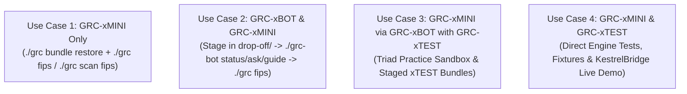

# FIPS 140-3 Cryptographic Discovery, CBOM & CMVP Assessment Guide (`docs/fips_discovery-guide.md`)

<p align="center">
  <a href="../README.md"><b>📖 README</b></a> &nbsp;·&nbsp;
  <a href="../INSTALL.md"><b>⚙️ Install Guide</b></a> &nbsp;·&nbsp;
  <a href="../COMMANDS.md"><b>⌨️ CLI Commands</b></a> &nbsp;·&nbsp;
  <a href="../amplifying-info/ARCHITECTURE.md"><b>🏛️ Architecture & Tech Stack</b></a> &nbsp;·&nbsp;
  <a href="../amplifying-info/DATAFLOW.md"><b>🔄 Data Flow</b></a> &nbsp;·&nbsp;
  <a href="../SECURITY.md"><b>🛡️ Security Policy</b></a> &nbsp;·&nbsp;
  <a href="../amplifying-info/GOVERNANCE.md"><b>⚖️ Governance & Mandates</b></a> &nbsp;·&nbsp;
  <a href="../testing/TESTING.md"><b>🧪 Verification Plan</b></a> &nbsp;·&nbsp;
  <a href="../testing/live-demo.md"><b>🎬 Live Demo</b></a> &nbsp;·&nbsp;
  <a href="../hygiene/RELEASE_NOTES.md"><b>🚀 Release Notes</b></a> &nbsp;·&nbsp;
  <a href="../hygiene/PATCH_LOG.md"><b>🩹 Patch Log Index</b></a> &nbsp;·&nbsp;
  <a href="../hygiene/ROADMAP.md"><b>🗺️ Roadmap</b></a> &nbsp;·&nbsp;
  <a href="../hygiene/RELEASING.md"><b>🏷️ Releasing</b></a> &nbsp;·&nbsp;
  <a href="transform_scans-guide.md"><b>📊 Scan-to-POA&M Guide</b></a> &nbsp;·&nbsp;
  <a href="grc_bundle-guide.md"><b>📑 Bundle Walkthrough</b></a> &nbsp;·&nbsp;
  <a href="fips_discovery-guide.md"><b>🔐 FIPS 140-3 Guide</b></a> &nbsp;·&nbsp;
  <a href="grc-xtest-guide.md"><b>🎯 GRC-xTEST Guide</b></a>
</p>

> **Engine**: [`scripts/fips_discovery.py`](../scripts/fips_discovery.py) (`FIPSDiscovery` v1.5.3 — Pipeline Engine #8)  
> **CLI Entrypoints**: `./grc fips`, `./grc scan fips` (`./grc scan --fips`), `./grc scan all`, `./grc test fips`, and `python3 scripts/fips_discovery.py`  
> **Governing Standards**: NIST FIPS 140-3 (SP 800-140C/D), NIST SP 800-131A Rev. 2, FIPS 186-5, NIST SP 800-52 Rev. 2, NIST SP 800-53 Rev. 5 (`SC-13`, `SC-12`, `SC-8`, `SC-8(1)`, `SC-28`, `SC-28(1)`, `IA-7`, `SC-23`, `SI-7`, `SI-17`, `CM-6`)  
> **Assessed Areas of Concern (AOCs)**: `AOC-03` (Weak/Deprecated Crypto), `AOC-05` (Improper TLS), `AOC-09` (EOL/Unvalidated Crypto Libraries), `AOC-12` (Lack of FIPS Mode)  
> **Execution Mode**: 100% Python 3.9+ Standard Library *(Host-native for `./grc fips`; Docker Desktop required only when invoking containerized engines via `./grc scan all`)*

---

## Table of Contents

1. [Overview & FIPS 140-3 Framing](#1-overview--fips-140-3-framing)
   * [1.1 What the Engine Evaluates](#11-what-the-engine-evaluates)
   * [1.2 The Five Conformance Determinations](#12-the-five-conformance-determinations)
2. [Complete CLI Flags & Options Reference](#2-complete-cli-flags--options-reference)
   * [2.1 Direct Flags for `scripts/fips_discovery.py` (`./grc fips`)](#21-direct-flags-for-scriptsfips_discoverypy-grc-fips)
   * [2.2 Choosing Between `./grc fips`, `./grc scan`, `./grc test`, and Direct Python](#22-choosing-between-grc-fips-grc-scan-grc-test-and-direct-python)
3. [Generated Deliverables & Evidence Layout (`artifacts/pick-up/`)](#3-generated-deliverables--evidence-layout-artifactspick-up)
4. [End-to-End Triad Use Cases](#4-end-to-end-triad-use-cases)
   * [4.1 Use Case 1: `GRC-xMINI` Only (Standalone Analyst & Engineering Workflow)](#41-use-case-1-grc-xmini-only-standalone-analyst--engineering-workflow)
   * [4.2 Use Case 2: `GRC-xBOT` & `GRC-xMINI` (Co-Pilot Guided Assessment of Staged Bundles)](#42-use-case-2-grc-xbot--grc-xmini-co-pilot-guided-assessment-of-staged-bundles)
   * [4.3 Use Case 3: `GRC-xMINI` Through `GRC-xBOT` with `GRC-xTEST` (Full Triad Sandbox & Training)](#43-use-case-3-grc-xmini-through-grc-xbot-with-grc-xtest-full-triad-sandbox--training)
   * [4.4 Use Case 4: `GRC-xMINI` & `GRC-xTEST` (Fixtures, Regressions & KestrelBridge Multi-Release Demo)](#44-use-case-4-grc-xmini--grc-xtest-fixtures-regressions--kestrelbridge-multi-release-demo)
5. [Inspecting Deliverables (`jq`) & Operational Notes](#5-inspecting-deliverables-jq--operational-notes)

---

## 1. Overview & FIPS 140-3 Framing

NIST CMVP validates **cryptographic modules** (and their Operational Environments), not application source repositories themselves. Accordingly, [`scripts/fips_discovery.py`](../scripts/fips_discovery.py) does not falsely claim that a repository is "FIPS certified." Instead, it gathers static evidence across code, dependencies, containers, Infrastructure-as-Code, and appliance OS configurations to answer three assessment questions:

1. **Module Validation**: Is security-relevant cryptography routed through a CMVP-validated module (tracked against [`rules/cmvp_catalog.json`](../rules/cmvp_catalog.json) and [`rules/crypto_catalog.json`](../rules/crypto_catalog.json))?
2. **Approved Mode Intent**: Do host, runtime, container, and provider configs enable FIPS approved mode (for example, kernel `fips=1`, `/etc/crypto-policies/config`, OpenSSL `[fips_sect] activate = 1`, `java.security` `BouncyCastleFipsProvider` / `setApprovedOnlyMode(true)`, Go `fips140=only`, Node.js `crypto.setFips(1)` / `--enable-fips`)?
3. **Approved Algorithms & Protocols**: Do algorithms, key sizes, modes, PRNGs/DRBGs, and TLS protocols conform to [`rules/fips_algorithm_policy.json`](../rules/fips_algorithm_policy.json)?

### 1.1 What the Engine Evaluates

| Surface | Inspection Method & Scope |
|---|---|
| **Python Source (`*.py`)** | AST inspection (`ast` module) for `hashlib`, `hmac`, `secrets` vs. `random`, `cryptography`, `pycryptodome`, `ssl` / TLS settings, and `usedforsecurity=False` context detection |
| **Polyglot Source (Go, Java/Kotlin, JS/TS, C/C++, Rust, C#/.NET)** | Comment-stripping lexical detectors covering Go `crypto/*` / `x/crypto` / `//go:debug fips140=...`, Java JCA/`BouncyCastleFipsProvider`, Node `crypto.setFips`, C/C++ OpenSSL EVP, RustCrypto, and .NET CNG |
| **Dependency Manifests** | `requirements.txt`, `pyproject.toml`, `go.mod`, `pom.xml`, `build.gradle`, `package.json`, `Cargo.toml`, etc. mapped to CMVP validation status (`Active`, `Historical`, `Unvalidated`, `Capable`) |
| **Deploy / Container / IaC** | `Dockerfile` (e.g., RHEL UBI 9 base images), `nginx.conf`, Kubernetes manifests (`minVersion`), Terraform (`ELB` / TLS policies), and Packer templates |
| **OS / Appliance Rootfs** | `/etc/default/grub` (`fips=0` vs. `fips=1`), `/etc/crypto-policies/config` (`DEFAULT` vs. `FIPS`), `/etc/ssl/openssl.cnf` (`fips_sect`), and `java.security` provider order |

> [!NOTE]
> `fips_discovery.py` inspects **unpacked directories** (restored Git bundles, local source checkouts, or cold-mounted AMI rootfs trees). It does **not** inspect `.bundle` files directly and does **not** monitor `artifacts/drop-off/` — unpack `.bundle` files first using `./grc bundle restore`.

### 1.2 The Five Conformance Determinations

Where static analysis alone cannot verify runtime FIPS mode or Operational Environment (OE) binding—such as when a FIPS-capable library appears in a component directory whose own `Dockerfile` / runtime lacks approved-mode evidence—`fips_discovery.py` explicitly avoids emitting `PASS`. Container `Dockerfile` base-image (`ubi9`) and Python `cryptography` linkage checks (`dnf install python3-cryptography` or `pip install --no-binary cryptography` / `PIP_NO_BINARY=cryptography` vs. prebuilt PyPI wheels bundling non-FIPS OpenSSL) are scoped strictly to the owning component's directory tree (`H7`), while appliance OS configurations under `appliance/rootfs/etc/` (`/etc/default/grub`, `/etc/crypto-policies/config`, `/etc/pki/tls/openssl.cnf`) supply deployment-level OE evidence:

| Determination | Meaning | Example |
|---|---|---|
| **`PASS`** | Validated module evidence + component-scoped/appliance approved-mode evidence + approved algorithm/parameters | AES-256-GCM via `secrets`, SHA-384 manifest, source-built/system-linked `cryptography` on UBI 9 CMVP `#4857` (`--no-binary cryptography`), `fips=1` + `FIPS` crypto-policy + active `fips_sect` |
| **`FAIL`** | Disallowed algorithm/protocol, explicit non-FIPS toggle, or unvalidated/historical crypto module | MD5 security digest, AES-ECB, RSA-1024, TLS 1.0/1.1, `fips=0`, `pycryptodome`, `golang.org/x/crypto`, `bc-fips` 1.0.2.5 (Historical) |
| **`WARN`** *(reserved in `v1.5.3`)* | Reserved in Finding Schema v1.0.0 and policy engine for transitional or advisory notices (no active rule in `v1.5.3` currently emits `WARN`) | Transitional parameter notice or policy/catalog advisory |
| **`NEEDS_REVIEW`** | Context-dependent or legacy transition item requiring ISSO/assessor confirmation | `hashlib.md5(..., usedforsecurity=False)` for cache keys (`cache.py`), ECDSA `P-224` legacy partner receipt verification |
| **`CANNOT_DETERMINE_STATICALLY`** | FIPS-capable wrapper is present, but its owning component/workspace lacks static evidence of approved-mode binding | `cryptography==42.0.5` in `gateway/requirements.txt` installed from a prebuilt PyPI wheel or in a component lacking UBI 9 / OpenSSL FIPS linkage (even if an unrelated `docs-site/Dockerfile` uses UBI 9) |

---

## 2. Complete CLI Flags & Options Reference

### 2.1 Direct Flags for `scripts/fips_discovery.py` (`./grc fips`)

Running `./grc fips [options]` invokes `python3 scripts/fips_discovery.py [options]` natively on the host without Docker:

```text
usage: grc fips [-h] [-w WORKSPACE] [-e EVIDENCE] [--dry-run]
                [-f {all,terminal,json,markdown,sarif,cbom,cmvp}] [-o OUTPUT]
                [--policy POLICY] [--cmvp-catalog CMVP_CATALOG]
                [--crypto-catalog CRYPTO_CATALOG]
                [--staleness-days STALENESS_DAYS] [--allow-empty]
                [--fail-on {FAIL,NEEDS_REVIEW,never}]
```

| Flag | Short | Argument / Choices | Default | Behavior & Operational Notes |
|---|---|---|---|---|
| `--workspace` | `-w` | `<dir>` | `.` | Path to unpacked bundle directory (e.g., `./ephemeral_workspace`), local source repo, or cold-mounted AMI rootfs (`./ephemeral_ami_rootfs`). Fails fatally (`exit 1`) if the path does not exist, or if a `.bundle` file or non-directory path is supplied (printing an explicit `./grc bundle restore ...` remediation hint). |
| `--evidence` | `-e` | `<dir>` | `artifacts/pick-up/<YYYY-MM-DD_HHMMSS>_<bundle-stem>@<ref>_fips` *(UTC)* | Destination directory for the 6 FIPS deliverables + `sha256sum` when `--format all` runs without `--dry-run`. Created automatically if absent. When omitted, auto-named folders append `_2`, `_3`, … on same-second collisions (`M8`) and include `@<ref>` when a bundle ref/tag was checked out (`M3`). |
| `--dry-run` | — | *(boolean switch)* | `False` | Evaluates the workspace and prints the terminal preview (or selected single `--format` output to stdout) **without writing any files to disk**. |
| `--format` | `-f` | `all`, `terminal`, `json`, `markdown`, `sarif`, `cbom`, `cmvp` | `all` | Controls output rendering:<br>• `all`: Writes all 6 deliverables + `sha256sum` to `--evidence` (unless `--dry-run` is set) and prints summary.<br>• `terminal`: Prints human-readable summary & findings to stdout only.<br>• `json`: Renders `fips_findings.json` envelope.<br>• `markdown`: Renders `fips_assessment.md`.<br>• `sarif`: Renders SARIF 2.1.0 (`fips_findings.sarif`) for `FAIL`/`WARN`/`NEEDS_REVIEW`/`CANNOT_DETERMINE_STATICALLY` findings.<br>• `cbom`: Renders CycloneDX 1.6 CBOM (`cbom.cdx.json`).<br>• `cmvp`: Renders CMVP validation mapping table (`cmvp_mapping.md`). |
| `--output` | `-o` | `<file>` | `None` | Writes the single rendered artifact to `<file>` (creating parent directories as needed) when `-f` is `json`, `markdown`, `sarif`, `cbom`, or `cmvp`. **Ignored when `--dry-run` is set** (prints to stdout instead). |
| `--policy` | — | `<path>` | `rules/fips_algorithm_policy.json` | Overrides the FIPS algorithm/protocol policy JSON used for allowed/disallowed checks. |
| `--cmvp-catalog` | — | `<path>` | `rules/cmvp_catalog.json` | Overrides the offline NIST CMVP validated module snapshot catalog JSON. |
| `--crypto-catalog` | — | `<path>` | `rules/crypto_catalog.json` | Overrides the cryptographic library and EOL version catalog JSON. |
| `--staleness-days` | — | `<int>` | `90` | Overrides the age threshold (in days) before the offline CMVP catalog emits a staleness warning in `fips_provenance.json` and Markdown reports. |
| `--allow-empty` | — | *(boolean switch)* | `False` | Permits a `0`-file workspace scan to exit `0` (and write empty-scope deliverables if not in `--dry-run`). Without `--allow-empty`, inspecting `0` assessable files across Python, polyglot source, manifests, deploy/IaC, and OS config emits `[WARN]` on `stderr` and exits with code `2`. |
| `--fail-on` | — | `FAIL`, `NEEDS_REVIEW`, `never` | `never` | Controls policy-gate exit code after an assessment (`M1`):<br>• `never`: Exit `0` regardless of findings (still exits `2` on `0` inspected files unless `--allow-empty`).<br>• `FAIL`: Exit `1` when any `FAIL` or `WARN` finding exists.<br>• `NEEDS_REVIEW`: Exit `1` when any `FAIL`, `WARN`, `NEEDS_REVIEW`, or `CANNOT_DETERMINE_STATICALLY` finding exists. |
| `--help` | `-h` | *(boolean switch)* | — | Displays CLI help and exits. |

### 2.2 Choosing Between `./grc fips`, `./grc scan`, `./grc test`, and Direct Python

| Command | Docker Required? | Runs `grc_reporter.py` (POA&M / SCR-SCN)? | When to Use |
|---|---|---|---|
| `./grc fips -w <dir> [flags]` | **No** | No | Direct host-native FIPS assessment, `--dry-run` terminal previews, single-format exports (`-f cbom`, `-f sarif`, etc.), custom policy/catalog testing, CI policy gating (`--fail-on`), and the 6 FIPS deliverables + `sha256sum`. |
| `./grc scan fips -w <dir> [-e <dir>] [--no-report]` *(or `./grc scan --fips`)* | **No** | **Yes** *(unless `--no-report`)* | Runs `fips_discovery.py` into `<evidence>` (defaults to `artifacts/pick-up/<YYYY-MM-DD_HHMMSS>_<bundle-stem>@<ref>` UTC), copies workspace `bundle_provenance.json` / `ami_provenance.json`, and synthesizes `poam_data.md`, `controls.md`, `ruleset_validation.md`, and `scr_scn_package.json` (including `**Engines Run**: FIPSDiscovery (...)`). *(Note: `./grc scan` only accepts `-w/--workspace`, `-e/--evidence`, `--engine`/`--fips`, and `--no-report`; use `./grc fips` for `--dry-run`, `-f`, `-o`, `--policy`, `--staleness-days`, or `--fail-on`.)* |
| `./grc scan --host-only -w <dir> [-e <dir>]` | **No** | **Yes** *(unless `--no-report`)* | Runs host-native engines only (`crypto_lib_scan.py`, `fips_discovery.py`, and `sbom_analyzer.py` when an existing `sbom.cdx.json` is present) without requiring Docker Desktop (`M7`). |
| `./grc scan all -w <dir> [-e <dir>]` | **Yes** *(Docker Desktop)* | **Yes** *(unless `--no-report`)* | Full 10-engine audit: 7 containerized scanners (`grc-scanner:local` under `--network none`) + host-native `crypto_lib_scan.py` + `fips_discovery.py` + `sbom_analyzer.py` + Phase 4 reporter. Fails fast before creating `artifacts/pick-up/` if the Docker daemon is stopped (`M7`). |
| `./grc test fips` | **No** | No | Executes the unit and invariant test suite validating `fips_discovery.py` determinations, redaction, CBOM/SARIF builders, and CMVP mapping logic. |
| `python3 scripts/fips_discovery.py [flags]` | **No** | No | Identical to `./grc fips [flags]`; useful inside CI scripts or cross-repo harnesses such as `GRC-xTEST/scripts/verify_pipeline.sh`. |

---

## 3. Generated Deliverables & Evidence Layout (`artifacts/pick-up/`)

When run without `--dry-run` and with default `--format all`, [`write_deliverables()`](../scripts/fips_discovery.py) writes **7 sealed files** into the evidence directory (where `<YYYY-MM-DD_HHMMSS>` timestamps are generated in **UTC**):

* **Default path via `./grc fips -w <ws>`**: `GRC-xMINI/artifacts/pick-up/<YYYY-MM-DD_HHMMSS>_<bundle-stem>@<ref>_fips/` *(or `_<target>_fips`; `_2`, `_3`, ... on same-second collisions)*
* **Default path via `./grc scan fips -w <ws>`**: `GRC-xMINI/artifacts/pick-up/<YYYY-MM-DD_HHMMSS>_<bundle-stem>@<ref>/` *(or `<timestamp>/` if no `bundle_provenance.json` is present)*

| File | Schema / Format | Contents & Consumer |
|---|---|---|
| `fips_findings.json` | GRCx Finding Envelope v1.0.0 | Normalized FIPS findings (`FAIL`, `WARN`, `NEEDS_REVIEW`, `CANNOT_DETERMINE_STATICALLY`, `PASS`), target metadata, `scope.files_inspected` coverage breakdown (`total`, `python`, `polyglot_source`, `manifests`, `deploy_iac`, `os_config`, `workspace_files_total`), catalog hashes, NIST controls, and AOC tags; consumed by `grc_reporter.py` and `jq`. |
| `cbom.cdx.json` | CycloneDX 1.6 JSON | Cryptographic Bill of Materials listing discovered cryptographic assets (algorithms, modes, parameter identifiers, protocols, certificates, and dependency-level crypto components). |
| `fips_findings.sarif` | SARIF v2.1.0 | Actionable findings (`FAIL` -> `error`, `WARN` -> `warning`, `NEEDS_REVIEW`/`CANNOT_DETERMINE_STATICALLY` -> `note`; excludes `PASS`) ready for CI/CD code-scanning ingestion. |
| `cmvp_mapping.md` | Markdown | Dependency-to-CMVP module validation table (`Active`, `Historical`, `Unvalidated`, `Capable`), certificate numbers, and approved-mode evidence tags. |
| `fips_assessment.md` | Markdown | Executive & technical conformance report summarizing determinations, files inspected, scope limitations, catalog staleness, and actionable findings. |
| `fips_provenance.json` | `grc-fips-provenance-v1` | Chain-of-custody record capturing target identifier, commit SHA, `files_inspected` counts, SHA-256 digests of the 3 rule catalogs, CMVP integrity verification, and staleness status. |
| `sha256sum` | SHA-256 Digest Manifest | Cryptographic checksum manifest sealing every generated deliverable in the pick-up folder. |

> [!TIP]
> If you ran `./grc fips -w ./ephemeral_workspace` standalone and later decide you also want Phase 4 SCR/SCN and POA&M synthesis (`poam_data.md`, `controls.md`, `ruleset_validation.md`, `scr_scn_package.json`), run `./grc report -e artifacts/pick-up/<that_fips_folder>` afterward. When `scope.files_inspected.total == 0` (from an intentional `--allow-empty` run), `grc_reporter.py` sets `Overall Audit Posture` to **`NOT ASSESSED (No Assessable Files Found)`** and keeps controls at `NOT_ASSESSED`, whereas populated workspaces with `> 0` inspected files and `0` failures (such as KestrelBridge `v2.0.0` with `22` inspected files) report **`COMPLIANT (Clean Out-of-Band Audit)`**.

---

## 4. End-to-End Triad Use Cases



---

### 4.1 Use Case 1: `GRC-xMINI` Only (Standalone Analyst & Engineering Workflow)

**Scenario**: You only have `GRC-xMINI` installed on your workstation and need to perform a static FIPS 140-3 assessment on a software release bundle, a local application repository, or a cold-mounted AWS AMI rootfs — completely offline and without needing `GRC-xBOT` or `GRC-xTEST`.

#### Step 1: Prepare the Target Workspace

* **If auditing a Git `.bundle`** (`vendor-release.bundle`):
  ```bash
  cd ~/Desktop/GRC-xMINI

  # Phase 1: Verify SHA-256 & Git packfile integrity before unpacking
  ./grc bundle verify /path/to/vendor-release.bundle

  # Phase 2: Restore into an isolated read-only workspace
  # (-r selects a release tag—recommended on multi-tag bundles and required if a bundle lacks HEAD;
  #  optional on single-version bundles that carry HEAD)
  ./grc bundle restore /path/to/vendor-release.bundle \
    -w ./ephemeral_workspace \
    -r v1.0.0 \
    -f --read-only
  ```
  > What `-f --read-only` does: `-f` (`--force`) overwrites `./ephemeral_workspace` if a previous run left one behind; `--read-only` removes write permissions across the extracted files so scanners cannot mutate audited code.

* **If auditing a local repository directly** (no bundle needed): skip Step 1 and pass `-w /path/to/local-repo` directly.

* **If auditing a cold-mounted AMI rootfs**: follow [`docs/ami-review-workflow.md`](ami-review-workflow.md) (`./grc ami restore ... -w ./ephemeral_ami_rootfs`) and pass `-w ./ephemeral_ami_rootfs`.

#### Step 2: Run a Fast Non-Destructive Terminal Preview (`--dry-run`)

```bash
./grc fips -w ./ephemeral_workspace --dry-run
```

Confirm finding counts (`FAIL`, `WARN`, `Indeterminate / Needs Review`, `PASS`, `CBOM Cryptographic Assets`) without writing anything to `artifacts/pick-up/`.

#### Step 3: Generate the Sealed 7-File FIPS Package

```bash
./grc fips -w ./ephemeral_workspace
```

Inspect the printed path at the bottom (`[SUCCESS] Wrote 7 FIPS assessment deliverables to: .../artifacts/pick-up/<YYYY-MM-DD_HHMMSS>_<bundle-stem>@<ref>_fips`, UTC timestamp).

#### Step 4: Single-Format, Policy Gate & Custom Catalog Invocations (Optional)

```bash
# Export only a CycloneDX 1.6 CBOM for downstream tooling
./grc fips -w ./ephemeral_workspace -f cbom -o ./artifacts/pick-up/app-cbom.cdx.json

# Export only SARIF 2.1.0 for CI code scanning
./grc fips -w ./ephemeral_workspace -f sarif -o ./artifacts/pick-up/app-fips.sarif

# Enforce CI policy gates (--fail-on FAIL or NEEDS_REVIEW; default is 'never')
./grc fips -w ./ephemeral_workspace --dry-run --fail-on FAIL
./grc fips -w ./ephemeral_workspace --dry-run --fail-on NEEDS_REVIEW

# Export CMVP lineage markdown with a stricter 60-day catalog staleness threshold
./grc fips -w ./ephemeral_workspace -f cmvp --staleness-days 60 -o ./artifacts/pick-up/cmvp_lineage.md

# Or use custom org policy/catalog overrides
./grc fips -w ./ephemeral_workspace \
  --policy ./rules/fips_algorithm_policy.json \
  --cmvp-catalog ./rules/cmvp_catalog.json \
  --crypto-catalog ./rules/crypto_catalog.json
```

#### Step 5: Synthesize Full Phase 4 POA&M + SCR/SCN Package & Clean Up

```bash
# Option A: Chain fips + grc_reporter.py in one command
./grc scan --fips -w ./ephemeral_workspace

# Option B: Run all host-native engines (crypto + fips, plus sbom if sbom.cdx.json exists) + reporter without Docker
./grc scan --host-only -w ./ephemeral_workspace

# Option C: Or run Phase 4 reporter on an already-generated ./grc fips folder
./grc report -e artifacts/pick-up/<YYYY-MM-DD_HHMMSS>_<bundle-stem>@<ref>_fips

# Phase 5: Always clean up ephemeral bundle workspace
./grc bundle clean -w ./ephemeral_workspace
```

*(If Docker Desktop is running and you want the other 7 containerized engines alongside FIPS, run `./grc scan all -w ./ephemeral_workspace` before cleaning up.)*

---

### 4.2 Use Case 2: `GRC-xBOT` & `GRC-xMINI` (Co-Pilot Guided Assessment of Staged Bundles)

**Scenario**: An analyst or ISSO uses **`GRC-xBOT`** (`v1.5.3 — Tsukuba`) as a guided co-pilot alongside **`GRC-xMINI`** to audit an incoming production `.bundle` staged in `GRC-xMINI/artifacts/drop-off/`. Because `GRC-xBOT` actively watches `../GRC-xMINI/artifacts/drop-off/`, `../GRC-xMINI/artifacts/pick-up/`, and `../GRC-xMINI/ephemeral_workspace`, it tailors exact `GRC-xMINI` commands around your staged files.

> [!IMPORTANT]
> Two architectural notes when pairing `GRC-xBOT` with `fips_discovery.py`:
> 1. `GRC-xBOT` (`v1.5.3 — Tsukuba`) routes `"fips"`, `"140-3"`, `"cmvp"`, `"cbom"`, and `"aoc-12"` intents directly to its dedicated **`fips` playbook** (`./grc fips -w <workspace> --dry-run` preview, followed by `./grc fips ... && ./grc report ...`), separates general EOL crypto scans under its **`crypto` playbook**, and routes full multi-engine bundle reviews through its **`bundle` playbook** (`./grc scan -w ./ephemeral_workspace`).
> 2. When `artifacts/drop-off/` contains a `.bundle` and `./ephemeral_workspace` does not yet exist, `GRC-xBOT`'s `fips`, `crypto`, and `bundle` playbooks restore the selected release tag read-only before scanning and disclose any skipped bundles or release tags.

#### Step 1: Stage Your Release Bundle into `GRC-xMINI/artifacts/drop-off/`

```bash
cp /path/to/vendor-release.bundle ~/Desktop/GRC-xMINI/artifacts/drop-off/
```

#### Step 2: Inspect Live Workspace State from `GRC-xBOT`

```bash
cd ~/Desktop/GRC-xBOT
./grc-bot status
```

Confirm that `GRC-xBOT` reports `vendor-release.bundle` inside `../GRC-xMINI/artifacts/drop-off/` and confirms `../GRC-xMINI` health.

#### Step 3: Ask `GRC-xBOT` or Launch the Guided Co-Pilot

```bash
# Deterministic intent routing (Mode 1: Legacy — zero LLM calls)
./grc-bot ask "Audit vendor-release.bundle for FIPS 140-3 mode, CMVP modules, and weak crypto"

# Or jump directly into the FIPS 140-3 or full bundle walkthrough
./grc-bot guide fips
# ./grc-bot guide bundle

# Optional: Mode 2 (Local Open-Weight Gemma 4 co-pilot over 127.0.0.1:11434)
# ./grc-bot --mode gemma4 ask "Explain what FIPS evidence we need from vendor-release.bundle"
```

#### Step 4: Execute Preview-First Flow, Then Capture Full FIPS Deliverables

Run `./grc-bot chat` and select the `fips` workflow (or let plain-English routing match it). When multiple staged bundles or multiple release tags exist, `GRC-xBOT` prompts for the target bundle and release tag (`M6`, defaulting to the highest semver tag while warning about skipped tags), confirms `[y/N]` for the Step 1 `--dry-run` preview, and confirms `[y/N]` for Step 2 live execution (`./grc fips` + `./grc report` into `artifacts/pick-up/<ts>_fips`).

If you skipped live execution in chat and want to run the manual `GRC-xMINI` sequence directly:

```bash
cd ~/Desktop/GRC-xMINI

# 1. Verify and restore the staged bundle
#    (-r <tag> is required for HEAD-less bundles and recommended for multi-tag bundles;
#     optional on single-release bundles that carry HEAD)
./grc bundle verify artifacts/drop-off/vendor-release.bundle
./grc bundle restore artifacts/drop-off/vendor-release.bundle \
  -w ./ephemeral_workspace -r v1.0.0 -f --read-only

# 2. Preview & write full FIPS 140-3 deliverables (Engine #8)
./grc fips -w ./ephemeral_workspace --dry-run
./grc fips -w ./ephemeral_workspace

# 3. Synthesize Phase 4 SCR/SCN + POA&M (or run './grc-bot guide report')
./grc report -e artifacts/pick-up/<YYYY-MM-DD_HHMMSS>_<bundle-stem>@<ref>_fips

# 4. Clean up the ephemeral workspace when done
./grc bundle clean -w ./ephemeral_workspace
```

Finish by running `./grc-bot status` from `~/Desktop/GRC-xBOT` to verify the new timestamped pick-up folder appears in `artifacts/pick-up/`.

---

### 4.3 Use Case 3: `GRC-xMINI` Through `GRC-xBOT` with `GRC-xTEST` (Full Triad Sandbox & Training)

**Scenario**: You have the complete **GRCx Initiative Triad** side-by-side (`~/Desktop/GRC-xMINI`, `~/Desktop/GRC-xBOT`, `~/Desktop/GRC-xTEST`) and want to onboard an analyst, rehearse a FIPS audit via `GRC-xBOT`, or run guided sandbox exercises without touching production data.

There are **two Triad workflows** depending on whether `GRC-xMINI/artifacts/drop-off/` is empty or staged with a `GRC-xTEST` FIPS bundle:

#### Pattern A: Zero-Staging Triad Practice (Requires AOC Bundles in `GRC-xTEST`)

When `GRC-xMINI/artifacts/drop-off/` has **no `.bundle` files**, `GRC-xBOT` automatically falls back to `../GRC-xTEST/bundles/aoc-12-no-fips-mode.bundle` in its `fips` guide (`../GRC-xTEST/bundles/aoc-combo-4x.bundle` in `crypto` and `bundle`), and runs the full test harness in `practice`. *(If your `GRC-xTEST/bundles/` checkout only contains the **KestrelBridge** scenario bundles without the 12 AOC bundles, skip to **Pattern B** below and stage a KestrelBridge bundle.)*

```bash
cd ~/Desktop/GRC-xBOT

# 1. Verify all three Triad repos and drop-off/pick-up state
./grc-bot status

# 2. Run guided practice overview (executes './grc test all' — includes fips tests — and stages safe PoA&M fixtures)
./grc-bot guide practice

# 3. Watch GRC-xBOT synthesize commands using ../GRC-xTEST/bundles/aoc-12-no-fips-mode.bundle automatically
./grc-bot guide fips
```

When prompted inside `./grc-bot chat` (with `practice` or `fips` selected), `GRC-xBOT` previews the practice bundle from `../GRC-xTEST/bundles/`, restores it read-only into `../GRC-xMINI/ephemeral_workspace`, scans it, and cleans it up.

#### Pattern B: Staging a Dedicated `GRC-xTEST` FIPS Bundle into `GRC-xBOT` *(Works for AOC or KestrelBridge-Only)*

If you want `GRC-xBOT` to walk an analyst specifically through **KestrelBridge** (`v1.0.0` / `v1.5.0` / `v2.0.0`) or **AOC-12 (No FIPS Mode)**:

```bash
# 1. Stage a KestrelBridge bundle (works in KestrelBridge-only setups) OR AOC-12 from GRC-xTEST:
cp ~/Desktop/GRC-xTEST/bundles/kestrelbridge-fips.bundle ~/Desktop/GRC-xMINI/artifacts/drop-off/
# Or a single-release KestrelBridge bundle (omits multi-tag prompts):
# cp ~/Desktop/GRC-xTEST/bundles/kestrelbridge-v1.5.0.bundle ~/Desktop/GRC-xMINI/artifacts/drop-off/
# Or, when the AOC bundle corpus is present:
# cp ~/Desktop/GRC-xTEST/bundles/aoc-12-no-fips-mode.bundle ~/Desktop/GRC-xMINI/artifacts/drop-off/

# 2. Launch GRC-xBOT and confirm it detects the staged bundle & semantic release tags
cd ~/Desktop/GRC-xBOT
./grc-bot status
./grc-bot ask "Walk me through a FIPS 140-3 check on the staged bundle"
```

```bash
# 3. Follow the co-pilot workflow in GRC-xBOT interactive chat
./grc-bot chat
# Inside chat:
#   - Pick 'fips' (or 'bundle' if Docker Desktop is running for './grc scan')
#   - Select the target bundle and release tag if prompted (e.g., v1.0.0, v1.5.0, or default [v2.0.0])
#   - Approve Step 1 Preview ([y/N]), then approve Step 2 Live execution ([y/N]) when prompted
```

```bash
# 4. Optional manual fallback (only if you answered 'n' to Live execution in Step 3)
cd ~/Desktop/GRC-xMINI
./grc bundle restore artifacts/drop-off/kestrelbridge-fips.bundle -w ./ephemeral_workspace -r v1.5.0 -f --read-only
# Or, if you staged a single-release bundle built with HEAD (`-r` optional; required for HEAD-less bundles):
# ./grc bundle restore artifacts/drop-off/kestrelbridge-v1.5.0.bundle -w ./ephemeral_workspace -f --read-only
./grc fips -w ./ephemeral_workspace --dry-run
./grc fips -w ./ephemeral_workspace
./grc bundle clean -w ./ephemeral_workspace

# 5. Optional: remove the practice bundle from drop-off/ after rehearsal
rm -f ~/Desktop/GRC-xMINI/artifacts/drop-off/kestrelbridge-fips.bundle
```

---

### 4.4 Use Case 4: `GRC-xMINI` & `GRC-xTEST` (Fixtures, Regressions & KestrelBridge Multi-Release Demo)

**Scenario**: You want to verify `fips_discovery.py` against known-good (`PASS`) and known-bad (`FAIL` / `NEEDS_REVIEW` / `CANNOT_DETERMINE_STATICALLY`) test corpora in `GRC-xTEST`, run full regression validation, or deliver a live before-and-after remediation demo.

#### 4.4.1 Unit Tests, Direct Corpus Fixtures & Automated Pipeline Verification

```bash
# 1. Run GRC-xMINI's FIPS engine unit & invariant suite
cd ~/Desktop/GRC-xMINI
./grc test fips

# 2. Run fips_discovery.py directly against positive and negative multi-language corpora
#    (requires GRC-xTEST/fips-fixtures/ directory)
./grc fips -w ../GRC-xTEST/fips-fixtures/positive --dry-run
./grc fips -w ../GRC-xTEST/fips-fixtures/negative --dry-run

# 3. Run the automated GRC-xTEST pipeline harness (dynamically tests every bundle present
#    in GRC-xTEST/bundles/ — 4 KestrelBridge bundles / 6 tag snapshots, or 16 bundles / 18 snapshots
#    when the 12 AOC bundles are also present; [5/5] runs containers if Docker is up)
cd ~/Desktop/GRC-xTEST
./scripts/verify_pipeline.sh
```

#### 4.4.2 Individual Bundle Verification (KestrelBridge-Only or AOC Corpus)

If your `GRC-xTEST/bundles/` checkout only contains the **KestrelBridge** scenario bundles:

```bash
cd ~/Desktop/GRC-xMINI

# Verify legacy v1.0.0 baseline via KestrelBridge (no AOC bundles needed)
./grc bundle restore ../GRC-xTEST/bundles/kestrelbridge-v1.0.0.bundle -w ./ephemeral_kb -f --read-only
./grc fips -w ./ephemeral_kb --dry-run
./grc bundle clean -w ./ephemeral_kb
```

If the full **AOC bundle corpus** (`aoc-*.bundle`) is also present in `GRC-xTEST/bundles/`:

```bash
cd ~/Desktop/GRC-xMINI

# Verify AOC-12 (Non-FIPS Operating Mode)
./grc bundle restore ../GRC-xTEST/bundles/aoc-12-no-fips-mode.bundle -w ./ephemeral_aoc12 -r v1.0.0 -f --read-only
./grc fips -w ./ephemeral_aoc12 --dry-run
./grc bundle clean -w ./ephemeral_aoc12

# Verify AOC-03 (Legacy / Weak Cryptography)
./grc bundle restore ../GRC-xTEST/bundles/aoc-03-legacy-crypto.bundle -w ./ephemeral_aoc03 -r v1.0.0 -f --read-only
./grc fips -w ./ephemeral_aoc03 --dry-run
./grc bundle clean -w ./ephemeral_aoc03
```

#### 4.4.3 Live Demo: KestrelBridge 3-Stage Remediation (`v1.0.0` -> `v1.5.0` -> `v2.0.0`)

`GRC-xTEST` provides the realistic polyglot **KestrelBridge** B2B encryption platform in two forms so you can demo either style (see [`GRC-xTEST/scenarios/kestrelbridge/README.md`](../../GRC-xTEST/scenarios/kestrelbridge/README.md)):

> **Pre-flight for Docker-based `./grc scan --fips` demos**: If you plan to run `./grc scan --fips` (instead of host-native `./grc fips`), confirm Docker Desktop is up (`docker info >/dev/null 2>&1`) and `grc-scanner:local` is built (`./grc docker-build`) before recording.

**Expected Baseline Progression (`fips_discovery.py` v1.5.3):**

| Release | Story | FAIL | NEEDS_REVIEW | CANNOT_DETERMINE_STATICALLY | PASS |
|---|---|---|---|---|---|
| `v1.0.0` | Legacy Transfer Stack (ECB, RSA-1024, MD5, SHA-1, TLS 1.0/1.1, `fips=0`) | **31** | 0 | 0 | 1 |
| `v1.5.0` | App Crypto Migration (`secrets`, OAEP-SHA-256, `usedforsecurity=False`, P-224, unverified `cryptography==42.0.5`, missing `fips=1`) | **6** | **2** | **1** | 17 |
| `v2.0.0` | FIPS 140-3 Ready (UBI 9 CMVP #4857, `fips=1`, `FIPS` crypto-policy, active OpenSSL `fips_sect`, `fips140=only`, BC-FIPS approved-only) | 0 | 0 | 0 | **31** |

* **Option A — One Multi-Tag Bundle (`kestrelbridge-fips.bundle`, selecting tags with `-r`)**:

  > [!NOTE]
  > Omitting `-r` on a multi-tag bundle such as `kestrelbridge-fips.bundle` checks out `HEAD` (`v2.0.0`) and prints a `[WARN]` banner to `stderr` listing all available tags (`v1.0.0, v1.5.0, v2.0.0`) so earlier releases are not overlooked. Always pass `-r <tag>` when auditing a specific release.

  ```bash
  cd ~/Desktop/GRC-xMINI
  ./grc bundle verify ../GRC-xTEST/bundles/kestrelbridge-fips.bundle

  # Act I: Legacy baseline
  ./grc bundle restore ../GRC-xTEST/bundles/kestrelbridge-fips.bundle -w ./ephemeral_kb -r v1.0.0 -f --read-only
  ./grc fips -w ./ephemeral_kb --dry-run

  # Act II: Mid-migration (exercises NEEDS_REVIEW + CANNOT_DETERMINE_STATICALLY)
  ./grc bundle restore ../GRC-xTEST/bundles/kestrelbridge-fips.bundle -w ./ephemeral_kb -r v1.5.0 -f --read-only
  ./grc fips -w ./ephemeral_kb --dry-run

  # Act III: Remediated -> generate all 6 deliverables + sha256sum
  ./grc bundle restore ../GRC-xTEST/bundles/kestrelbridge-fips.bundle -w ./ephemeral_kb -r v2.0.0 -f --read-only
  ./grc fips -w ./ephemeral_kb

  ./grc bundle clean -w ./ephemeral_kb
  ```

* **Option B — Three Standalone Single-Version Bundles (Auditor Handoff Simulation, `-r` optional because each bundle includes `HEAD`; `grc_bundle.py` aborts and cleans up partial directories if a malformed `HEAD`-less bundle ever checks out empty)**:

  ```bash
  cd ~/Desktop/GRC-xMINI

  # Release 1 bundle
  ./grc bundle verify ../GRC-xTEST/bundles/kestrelbridge-v1.0.0.bundle
  ./grc bundle restore ../GRC-xTEST/bundles/kestrelbridge-v1.0.0.bundle -w ./ephemeral_kb -f --read-only
  ./grc fips -w ./ephemeral_kb --dry-run

  # Release 2 bundle
  ./grc bundle verify ../GRC-xTEST/bundles/kestrelbridge-v1.5.0.bundle
  ./grc bundle restore ../GRC-xTEST/bundles/kestrelbridge-v1.5.0.bundle -w ./ephemeral_kb -f --read-only
  ./grc fips -w ./ephemeral_kb --dry-run

  # Release 3 bundle -> generate all 6 deliverables + sha256sum in artifacts/pick-up/
  ./grc bundle verify ../GRC-xTEST/bundles/kestrelbridge-v2.0.0.bundle
  ./grc bundle restore ../GRC-xTEST/bundles/kestrelbridge-v2.0.0.bundle -w ./ephemeral_kb -f --read-only
  ./grc fips -w ./ephemeral_kb

  ./grc bundle clean -w ./ephemeral_kb
  ```

---

## 5. Inspecting Deliverables (`jq`) & Operational Notes

Use these commands on any generated folder inside `artifacts/pick-up/<UTC_timestamp>_<bundle-stem>@<ref>_fips/`:

```bash
EV="artifacts/pick-up/<YYYY-MM-DD_HHMMSS>_<bundle-stem>@<ref>_fips"

# 1. Verify cryptographic seal across all deliverables
(cd "$EV" && shasum -a 256 -c sha256sum)

# 2. Count findings grouped by FIPS determination
jq '.findings | group_by(.determination) | map({determination: .[0].determination, count: length})' \
  "$EV/fips_findings.json"

# 3. List FAIL, NEEDS_REVIEW, and CANNOT_DETERMINE_STATICALLY items with file + line
jq -r '.findings[] | select(.determination != "PASS") | "\(.determination)\t\(.rule_id)\t\(.location.path):\(.location.line_start // 0)\t\(.title)"' \
  "$EV/fips_findings.json"

# 4. Inspect CycloneDX 1.6 CBOM component count and names
jq '{specVersion, target: .metadata.component.name, assets: (.components | length), sample: [.components[:10][] | {name, type, crypto: .cryptoProperties.assetType}]}' \
  "$EV/cbom.cdx.json"

# 5. Check target ref, file coverage, provenance, and catalog staleness status
jq '{target, files_inspected: .scope.files_inspected}' "$EV/fips_findings.json"
jq '{target_identifier, commit_sha, files_inspected, staleness_warning, catalogs: [.catalogs[] | {path, sha256}]}' \
  "$EV/fips_provenance.json"
```

### Troubleshooting Quick Reference

| Symptom | Cause | Resolution |
|---|---|---|
| `[FATAL] Workspace path is a Git bundle file, not a directory` (or `Workspace path does not exist`) | Passed a `.bundle` file directly, passed a non-directory path, or misspelled `-w` directory | Run `./grc bundle restore <file.bundle> -w ./ephemeral_workspace -r <tag> -f --read-only` first, then pass `-w ./ephemeral_workspace`. |
| `[WARN] No assessable files found in workspace` (`exit 2`) or `NOT ASSESSED (No Assessable Files Found)` in `poam_data.md` | Target directory is empty, holds only metadata (`bundle_provenance.json`), or resulted from a bad `-w` path | Verify you restored the target bundle/repo properly (`ls` workspace). Pass `--allow-empty` only when intentionally testing empty-scope deliverables (`0` files inspected). |
| `restore_bundle` fails mentioning an `empty checkout` | Bundle lacks `HEAD` (or default branch) and `--ref` was omitted | Pass `-r <tag>` using one of the refs listed in the error message; no `-f` cleanup is needed because `grc_bundle.py` removes partial empty checkouts automatically. |
| `[ERROR] Docker daemon is not running` when running `./grc scan all` | Docker Desktop is stopped | Start the Docker daemon for full 10-engine container scans, or run `./grc scan --host-only -w <ws>` (host-native `crypto` + `fips` + optional `sbom` + Phase 4 report) without leaving an unsealed pick-up folder (`M7`). |
| Expected files not created in `artifacts/drop-off/` or missing output with `-o` | `--dry-run` was passed, or expecting `fips_discovery.py` to write to `drop-off/` | Remove `--dry-run` when ready to emit files; outputs are always written to `artifacts/pick-up/` (or `-e` / `-o`). |
| `./grc scan --fips` rejects `--dry-run`, `-f`, or `--fail-on` | `./grc scan` only accepts scan-wrapper options (`-w`, `-e`, `--engine`/`--fips`, `--host-only`, `--no-report`) | Run `./grc fips [flags]` directly for `--dry-run`, `-f`, `-o`, `--policy`, `--cmvp-catalog`, `--crypto-catalog`, `--staleness-days`, `--allow-empty`, and `--fail-on`; use `./grc scan --fips` or `./grc scan --host-only` when chaining `grc_reporter.py`. |
