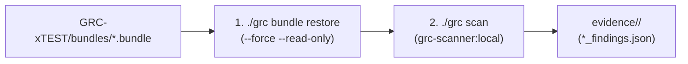

# GRC-xTEST Verification & Test Harness Guide (`docs/grc-xtest-guide.md`)

<p align="center">
  <a href="../README.md"><b>📖 README</b></a> &nbsp;·&nbsp;
  <a href="../INSTALL.md"><b>⚙️ Install Guide</b></a> &nbsp;·&nbsp;
  <a href="../COMMANDS.md"><b>⌨️ CLI Commands</b></a> &nbsp;·&nbsp;
  <a href="../amplifying-info/ARCHITECTURE.md"><b>🏛️ Architecture & Tech Stack</b></a> &nbsp;·&nbsp;
  <a href="../amplifying-info/DATAFLOW.md"><b>🔄 Data Flow</b></a> &nbsp;·&nbsp;
  <a href="../SECURITY.md"><b>🛡️ Security Policy</b></a> &nbsp;·&nbsp;
  <a href="../amplifying-info/GOVERNANCE.md"><b>⚖️ Governance & Mandates</b></a> &nbsp;·&nbsp;
  <a href="../testing/TESTING.md"><b>🧪 Verification Plan</b></a> &nbsp;·&nbsp;
  <a href="../testing/live-demo.md"><b>🎬 Live Demo</b></a> &nbsp;·&nbsp;
  <a href="../hygiene/RELEASE_NOTES.md"><b>🚀 Release Notes</b></a> &nbsp;·&nbsp;
  <a href="../hygiene/PATCH_LOG.md"><b>🩹 Patch Log Index</b></a> &nbsp;·&nbsp;
  <a href="../hygiene/ROADMAP.md"><b>🗺️ Roadmap</b></a> &nbsp;·&nbsp;
  <a href="../hygiene/RELEASING.md"><b>🏷️ Releasing</b></a> &nbsp;·&nbsp;
  <a href="transform_scans-guide.md"><b>📊 Scan-to-POA&M Guide</b></a> &nbsp;·&nbsp;
  <a href="grc_bundle-guide.md"><b>📑 Bundle Walkthrough</b></a> &nbsp;·&nbsp;
  <a href="grc-xtest-guide.md"><b>🎯 GRC-xTEST Guide</b></a>
</p>

> **Classification**: Internal DevSecOps & Security Compliance Specification  
> **Target Frameworks**: DISA STIG, NIST SP 800-53 Rev. 5, FedRAMP High, DoD Cloud Computing SRG  
> **Companion Repository**: [`GRC-xTEST`](https://github.com/eodartintlabs-hue/grc-xtest) (`../GRC-xTEST`)  
> **Operational Pattern**: Negative Testing, Control Verification & Ephemeral Isolation ($0 Cloud Cost)  

---

## Table of Contents

1. [Overview: What Is `GRC-xTEST`?](#1-overview-what-is-grc-xtest)
2. [Workstation Setup & Desktop Navigation Pathways](#2-workstation-setup--desktop-navigation-pathways)
   * [2.1 🍎 macOS Pathway (Terminal)](#21--macos-pathway-terminal)
   * [2.2 🪟 Windows Pathway (Command Prompt & PowerShell)](#22--windows-pathway-command-prompt--powershell)
3. [Testing the Scan Transformation Engine (`transform_scans.py`)](#3-testing-the-scan-transformation-engine-transform_scanspy)
   * [3.1 Testing on Windows (Command Prompt / PowerShell)](#31-testing-on-windows-command-prompt--powershell)
   * [3.2 Testing on macOS (Terminal)](#32-testing-on-macos-terminal)
4. [Testing the 5-Phase Git `.bundle` Review Pipeline](#4-testing-the-5-phase-git-bundle-review-pipeline)
   * [4.1 The 2-Step Testing Lifecycle (Restore -> Scan)](#41-the-2-step-testing-lifecycle-restore---scan)
   * [4.2 Automated Evidence Isolation & Directory Structure](#42-automated-evidence-isolation--directory-structure)
5. [Master AOC Verification Cheat Sheet (All 12 Test Bundles)](#5-master-aoc-verification-cheat-sheet-all-12-test-bundles)
   * [AOC-02: Password Hygiene (`IA-2`)](#-aoc-02-password-hygiene-nist-sp-800-53-ia-2)
   * [AOC-03: Weak Encryption Check (`SI-16`)](#️-aoc-03-weak-encryption-check-nist-sp-800-53-si-16)
   * [AOC-04: Command Injection (`SI-4`)](#-aoc-04-command-injection-nist-sp-800-53-si-4)
   * [AOC-05: Improper TLS (`SI-17`)](#-aoc-05-improper-tls-nist-sp-800-53-si-17)
   * [AOC-06: Secrets Management (`SC-12`)](#-aoc-06-secrets-management-nist-sp-800-53-sc-12)
   * [AOC-07: Infrastructure-as-Code Misconfiguration (`AC-6, CM-6`)](#️-aoc-07-infrastructure-as-code-iac-misconfiguration-nist-sp-800-53-ac-6-cm-6)
   * [AOC-09: Unsupported Cryptographic Libraries (`SI-7`)](#-aoc-09-unsupported-cryptographic-libraries-nist-sp-800-53-si-7)
   * [AOC-10: CRITICAL Severity Vulnerabilities (`RA-5, SI-2`)](#-aoc-10-critical-severity-vulnerabilities-nist-sp-800-53-ra-5-si-2)
   * [AOC-11: Category I DISA STIG Violations (`SI-2`)](#️-aoc-11-category-i-disa-stig-violations-nist-sp-800-53-si-2)
   * [AOC-12: Lack of FIPS Mode (`SC-13`)](#️-aoc-12-lack-of-fips-mode-nist-sp-800-53-sc-13)
   * [AOC-140: Organization-Specific Guardrails (`CM-6`)](#-aoc-140-organization-specific-guardrails-nist-sp-800-53-cm-6)
   * [AOC-Combo-4x: 4-in-1 Multi-Engine Combined Bundle (`02 + 04 + 07 + 09`)](#-aoc-combo-4x-4-in-1-multi-engine-combined-bundle-aoc-02--04--07--09)
6. [Automated Batch Verification (Run All 12 Bundle Tests)](#6-automated-batch-verification-run-all-12-bundle-tests)
7. [AMI Review Cold-Mount Mock Verification ($0 Cloud Compute Cost)](#7-ami-review-cold-mount-mock-verification-0-cloud-compute-cost)
8. [Auditor Evidence Deliverables & `jq` Inspection Cheat Sheet](#8-auditor-evidence-deliverables--jq-inspection-cheat-sheet)
9. [IDE & JSON Formatting Guide](#9-ide--json-formatting-guide)
10. [Troubleshooting & Frequently Asked Questions (FAQ)](#10-troubleshooting--frequently-asked-questions-faq)
11. [Ephemeral Workspace Teardown](#11-ephemeral-workspace-teardown)

---

## 1. Overview: What Is `GRC-xTEST`?

In high-assurance compliance automation, a security scanner that outputs zero findings cannot be trusted until it is mathematically proven capable of detecting real, deliberate violations.

**`GRC-xTEST`** (formerly *GRC Test Dummies*) is the official companion test corpus and synthetic verification harness for **GRCx**. It provides two distinct categories of synthetic test data:
1. **Pre-Compiled Git Release Bundles (`bundles/*.bundle`)**: 12 isolated Git bundle fixtures engineered to trigger every custom Semgrep AST rule, Gitleaks secret pattern, Checkov IaC check, Syft/Grype CVE trigger, and cryptographic library rule in the 5-phase review pipeline.
2. **Synthetic Vulnerability Scans & Previous POA&Ms (`scans/`)**: Synthetic **Tenable** (`.csv`/`.xlsx`) and **AWS Inspector** exports, paired with pre-populated baseline `OPEN FedRAMP-POAM.xlsx` workbooks, engineered to verify host auto-closure, SLA breach reporting, and multi-scan deduplication in [`scripts/transform_scans.py`](../scripts/transform_scans.py).

---

## 2. Workstation Setup & Desktop Navigation Pathways

Both repositories should reside side-by-side directly on the user's **Desktop**:
* `~/Desktop/GRC-x` (or `%USERPROFILE%\Desktop\GRC-x`)
* `~/Desktop/GRC-xTEST` (or `%USERPROFILE%\Desktop\GRC-xTEST`)

### 2.1 🍎 macOS Pathway (Terminal)

1. Open **Terminal** (`Cmd + Space`, search `Terminal`).
2. Navigate to your Desktop and clone both repositories:
   ```bash
   cd ~/Desktop
   git clone https://github.com/eodartintlabs-hue/grc-x.git GRC-x
   git clone https://github.com/eodartintlabs-hue/grc-xtest.git GRC-xTEST
   ```
3. Enter the `GRC-x` working directory:
   ```bash
   cd ~/Desktop/GRC-x
   ```
4. Verify the active version:
   ```bash
   ./grc fetch
   ```

---

### 2.2 🪟 Windows Pathway (Command Prompt & PowerShell)

#### Using Command Prompt (`cmd.exe`)
1. Open **Command Prompt** (search `cmd` in the Windows Start menu).
2. Navigate to your Desktop:
   ```cmd
   cd %USERPROFILE%\Desktop
   ```
3. Clone both repositories:
   ```cmd
   git clone https://github.com/eodartintlabs-hue/grc-x.git GRC-x
   git clone https://github.com/eodartintlabs-hue/grc-xtest.git GRC-xTEST
   ```
4. Enter the `GRC-x` working directory:
   ```cmd
   cd %USERPROFILE%\Desktop\GRC-x
   ```

#### Using PowerShell
1. Open **PowerShell** (search `PowerShell` in the Windows Start menu).
2. Navigate to your Desktop and enter `GRC-x`:
   ```powershell
   cd $HOME\Desktop
   cd GRC-x
   ```

---

## 3. Testing the Scan Transformation Engine (`transform_scans.py`)

`GRC-xTEST` provides synthetic Tenable and AWS Inspector scan fixtures designed to test the standalone transformation engine (`scripts/transform_scans.py`) without requiring Docker or a `.bundle` file.

### 3.1 Testing on Windows (Command Prompt / PowerShell)
Windows users execute `scripts\transform_scans.py` natively using standard Python 3.9+:

1. Copy the synthetic scan files from `GRC-xTEST` into your `GRC-x\scans\` folder:
   ```cmd
   copy ..\GRC-xTEST\scans\tenable_monthly_scan.csv .\scans\
   copy ..\GRC-xTEST\scans\previous_open_poam.xlsx .\scans\
   ```
2. Run the transformation engine:
   ```cmd
   python scripts\transform_scans.py --scan tenable_monthly_scan.csv --previous-open previous_open_poam.xlsx --draft-remediations y
   ```
3. Verify the generated FedRAMP deliverables inside `evidence\poam-tenable_monthly_scan\`:
   * `OPEN FedRAMP-POAM.xlsx`
   * `CLOSED FedRAMP-POAM.xlsx`
   * `poam_transform_summary.md`

### 3.2 Testing on macOS (Terminal)
1. Copy synthetic scan files into `scans/`:
   ```bash
   cp ../GRC-xTEST/scans/tenable_monthly_scan.csv ./scans/
   cp ../GRC-xTEST/scans/previous_open_poam.xlsx ./scans/
   ```
2. Run the transformation engine using `./grc transform`:
   ```bash
   ./grc transform \
     --scan tenable_monthly_scan.csv \
     --previous-open previous_open_poam.xlsx \
     --draft-remediations y
   ```
3. Inspect the terminal SLA aging report and inspect output files under `evidence/poam-tenable_monthly_scan/`.

---

## 4. Testing the 5-Phase Git `.bundle` Review Pipeline

### 4.1 The 2-Step Testing Lifecycle (Restore -> Scan)
Whenever you audit a synthetic bundle from `GRC-xTEST`, execute the exact two-step sequence: **Restore $\rightarrow$ Scan**.



```bash
# 1. Restore the synthetic bundle into an isolated, ephemeral workspace
./grc bundle restore ../GRC-xTEST/bundles/<bundle-name>.bundle \
  --workspace ./ephemeral_workspace \
  --ref v1.0.0 \
  --force --read-only

# 2. Run all compliance scanning engines
./grc scan -w ./ephemeral_workspace
```

The pipeline automatically:
* Verifies cryptographic SHA-256 bundle provenance (`bundle_provenance.json`).
* Locks extracted source code to read-only (`chmod -R 0444`) to enforce Zero Untrusted Code Execution.
* Mounts workspace into `grc-scanner:local` under `--network none`.
* Segregates audit deliverables into dedicated subdirectories under `evidence/<bundle-name>/`.

---

### 4.2 Automated Evidence Isolation & Directory Structure

```text
evidence/
├── aoc-02-weak-passwords/         <-- 16 hardcoded password/token findings across 4 languages
│   ├── bundle_provenance.json     # Ingestion & verification session record
│   ├── semgrep_findings.json      # Raw AST scanner output
│   ├── checkov_findings.json      # Raw IaC scanner output
│   ├── sbom.cdx.json              # CycloneDX system bill of materials
│   ├── poam_data.md               # Synthesized Plan of Action & Milestones (FedRAMP High)
│   ├── controls.md                # NIST SP 800-53 Rev. 5 Traceability Matrix
│   ├── ruleset_validation.md      # Itemized 37-rule Semgrep baseline log
│   ├── scr_scn_package.json       # Consolidated machine-readable SCR/SCN payload
│   └── sha256sum                  # Cryptographic evidence seal
│
├── aoc-03-legacy-crypto/          <-- MD5, SHA-1, DES, RC4, AES/ECB violations
├── aoc-07-iac-misconfig/          <-- Open S3 buckets, 0.0.0.0/0 SSH, unencrypted EBS
├── aoc-10-critical-cves/          <-- Log4Shell, Spring4Shell CVSS 9.8+ vulnerabilities
└── aoc-combo-4x/                  <-- 4-in-1 combined bundle (AOC-02 + AOC-04 + AOC-07 + AOC-09)
```

---

## 5. Master AOC Verification Cheat Sheet (All 12 Test Bundles)

Use these copy-pasteable commands from the `GRC-x` root to test any specific Area of Concern:

### 🔑 AOC-02: Password Hygiene (`NIST SP 800-53 IA-2`)
* **Target Flaws**: Hardcoded static passwords, database credentials, API tokens, and secret keys in Python, Go, Java, and JavaScript.
* **Commands**:
  ```bash
  ./grc bundle restore ../GRC-xTEST/bundles/aoc-02-weak-passwords.bundle -w ./ephemeral_workspace -r v1.0.0 -f --read-only
  ./grc scan -w ./ephemeral_workspace
  ```
* **Expected Output**: **16 findings** populated inside `evidence/aoc-02-weak-passwords/semgrep_findings.json`.

---

### 🛡️ AOC-03: Weak Encryption Check (`NIST SP 800-53 SI-16`)
* **Target Flaws**: Broken hash algorithms (`MD5`, `SHA-1`), broken symmetric ciphers (`DES`, `RC4`), and insecure `AES/ECB` block modes.
* **Commands**:
  ```bash
  ./grc bundle restore ../GRC-xTEST/bundles/aoc-03-legacy-crypto.bundle -w ./ephemeral_workspace -r v1.0.0 -f --read-only
  ./grc scan -w ./ephemeral_workspace
  ```
* **Expected Output**: Policy violations flagged in `evidence/aoc-03-legacy-crypto/semgrep_findings.json`.

---

### 💻 AOC-04: Command Injection (`NIST SP 800-53 SI-4`)
* **Target Flaws**: Unsanitized runtime shell execution via `os.system()`, `subprocess.Popen(shell=True)`, Go `exec.Command("bash", ...)`, and Java `Runtime.getRuntime().exec()`.
* **Commands**:
  ```bash
  ./grc bundle restore ../GRC-xTEST/bundles/aoc-04-command-injection.bundle -w ./ephemeral_workspace -r v1.0.0 -f --read-only
  ./grc scan -w ./ephemeral_workspace
  ```
* **Expected Output**: High-severity injection findings in `evidence/aoc-04-command-injection/semgrep_findings.json`.

---

### 🔒 AOC-05: Improper TLS (`NIST SP 800-53 SI-17`)
* **Target Flaws**: Deprecated `TLS 1.0/1.1` protocols, disabled certificate verification (`verify=False`, `InsecureSkipVerify: true`, `rejectUnauthorized: false`).
* **Commands**:
  ```bash
  ./grc bundle restore ../GRC-xTEST/bundles/aoc-05-improper-tls.bundle -w ./ephemeral_workspace -r v1.0.0 -f --read-only
  ./grc scan -w ./ephemeral_workspace
  ```
* **Expected Output**: Deprecated TLS and certificate check violations in `evidence/aoc-05-improper-tls/semgrep_findings.json`.

---

### 🗝️ AOC-06: Secrets Management (`NIST SP 800-53 SC-12`)
* **Target Flaws**: Embedded PEM/PKCS cryptographic private keys (`RSA PRIVATE KEY`, `OPENSSH PRIVATE KEY`) committed to source control.
* **Commands**:
  ```bash
  ./grc bundle restore ../GRC-xTEST/bundles/aoc-06-secrets-management.bundle -w ./ephemeral_workspace -r v1.0.0 -f --read-only
  ./grc scan -w ./ephemeral_workspace
  ```
* **Expected Output**: Private key violations flagged in `evidence/aoc-06-secrets-management/semgrep_findings.json` and `gitleaks_findings.json`.

---

### ☁️ AOC-07: Infrastructure-as-Code (IaC) Misconfiguration (`NIST SP 800-53 AC-6, CM-6`)
* **Target Flaws**: Public S3 buckets (`acl = "public-read"`), open `0.0.0.0/0` ingress SSH/RDP security groups, unencrypted EBS volumes in Terraform; disabled SELinux in Ansible playbooks.
* **Commands**:
  ```bash
  ./grc bundle restore ../GRC-xTEST/bundles/aoc-07-iac-misconfig.bundle -w ./ephemeral_workspace -r v1.0.0 -f --read-only
  ./grc scan -w ./ephemeral_workspace
  ```
* **Expected Output**: Policy check failures populated in `evidence/aoc-07-iac-misconfig/checkov_findings.json`.

---

### 📦 AOC-09: Unsupported Cryptographic Libraries (`NIST SP 800-53 SI-7`)
* **Target Flaws**: Deprecated, unmaintained, and EOL libraries: `pycrypto` (unmaintained since 2013), OpenSSL 1.1.1 (EOL September 2023), Bouncy Castle `< 1.70`.
* **Commands**:
  ```bash
  ./grc bundle restore ../GRC-xTEST/bundles/aoc-09-eol-libraries.bundle -w ./ephemeral_workspace -r v1.0.0 -f --read-only
  ./grc scan -w ./ephemeral_workspace
  ```
* **Expected Output**: `CRITICAL` EOL alerts in `evidence/aoc-09-eol-libraries/crypto_findings.json`.

---

### 🚨 AOC-10: CRITICAL Severity Vulnerabilities (`NIST SP 800-53 RA-5, SI-2`)
* **Target Flaws**: Dependencies containing known, weaponized CVSS 9.8–10.0 vulnerabilities:
  * Log4Shell (`log4j-core:2.14.1` — CVE-2021-44228)
  * Spring4Shell (`spring-beans:5.3.17` — CVE-2022-22965)
  * Text4Shell (`commons-text:1.9` — CVE-2022-42889)
* **Commands**:
  ```bash
  ./grc bundle restore ../GRC-xTEST/bundles/aoc-10-critical-cves.bundle -w ./ephemeral_workspace -r v1.0.0 -f --read-only
  ./grc scan -w ./ephemeral_workspace
  ```
* **Expected Output**: Critical CVE detections in `evidence/aoc-10-critical-cves/grype_findings.json` and `trivy_findings.json`.

---

### 🏛️ AOC-11: Category I DISA STIG Violations (`NIST SP 800-53 SI-2`)
* **Target Flaws**: Framework debug mode bound to `0.0.0.0`, plaintext HTTP listener (`http.ListenAndServe`), Java XML External Entity (XXE) processing enabled, and insecure cookie flags (`secure: false, httpOnly: false`).
* **Commands**:
  ```bash
  ./grc bundle restore ../GRC-xTEST/bundles/aoc-11-stig-cat1.bundle -w ./ephemeral_workspace -r v1.0.0 -f --read-only
  ./grc scan -w ./ephemeral_workspace
  ```
* **Expected Output**: All 4 `grc-aoc11-*` CAT I rules triggered in `evidence/aoc-11-stig-cat1/semgrep_findings.json`.

---

### 🛡️ AOC-12: Lack of FIPS Mode (`NIST SP 800-53 SC-13`)
* **Target Flaws**: Linux kernel bootloader with `fips=0` in GRUB parameters, system-wide crypto policies set to `DEFAULT` instead of `FIPS`, OpenSSL 3.0 configuration missing `[fips_sect] activate = 1`.
* **Commands**:
  ```bash
  ./grc bundle restore ../GRC-xTEST/bundles/aoc-12-no-fips-mode.bundle -w ./ephemeral_workspace -r v1.0.0 -f --read-only
  ./grc scan -w ./ephemeral_workspace
  ```
* **Expected Output**: Non-FIPS configuration flags recorded in `evidence/aoc-12-no-fips-mode/semgrep_findings.json`.

---

### 🏢 AOC-140: Organization-Specific Guardrails (`NIST SP 800-53 CM-6`)
* **Target Flaws**: Cleartext passwords, tokens, and API keys printed to `stdout`, `logging`, or `console.log` across Python, Go, Java, and JavaScript.
* **Commands**:
  ```bash
  ./grc bundle restore ../GRC-xTEST/bundles/aoc-140-org-guardrails.bundle -w ./ephemeral_workspace -r v1.0.0 -f --read-only
  ./grc scan -w ./ephemeral_workspace
  ```
* **Expected Output**: All 4 `grc-aoc140-*` rules triggered in `evidence/aoc-140-org-guardrails/semgrep_findings.json`.

---

### 🧩 AOC-Combo-4x: 4-in-1 Multi-Engine Combined Bundle (`AOC-02 + 04 + 07 + 09`)
* **Target Flaws**: Combines hardcoded credentials (`AOC-02`), command injection (`AOC-04`), Terraform S3/SG/EBS misconfigurations (`AOC-07`), and EOL `pycrypto` / outdated `cryptography` (`AOC-09`) inside a single release bundle.
* **Commands**:
  ```bash
  ./grc bundle restore ../GRC-xTEST/bundles/aoc-combo-4x.bundle -w ./ephemeral_workspace -r v1.0.0 -f --read-only
  ./grc scan -w ./ephemeral_workspace
  ```
* **Expected Output**: **19 total findings** (14 `CRITICAL / CAT I`, 5 `HIGH / CAT II`) across `Semgrep`, `Checkov`, and `CryptoScan` in `evidence/aoc-combo-4x/poam_data.md`.

---

## 6. Automated Batch Verification (Run All 12 Bundle Tests)

To audit and verify the entire 12-bundle test corpus in a single pass without manual intervention, run this loop from the root of the `GRC-x` directory:

```bash
DUMMY_DIR="../GRC-xTEST/bundles"

for bundle in "${DUMMY_DIR}"/*.bundle; do
    bundle_name="$(basename "${bundle}" .bundle)"
    echo "=========================================================="
    echo "  [+] Testing: ${bundle_name}"
    echo "=========================================================="
    
    # 1. Restore bundle with force overwrite and read-only protection
    ./grc bundle restore "${bundle}" \
      --workspace ./ephemeral_workspace \
      --ref v1.0.0 \
      --force --read-only
      
    # 2. Run all compliance engines + Phase 4 synthesis
    ./grc scan -w ./ephemeral_workspace
done

echo "[*] All 12 synthetic bundles audited! Check evidence/ for deliverables."
```

---

## 7. AMI Review Cold-Mount Mock Verification ($0 Cloud Compute Cost)

The pipeline supports out-of-band auditing of Amazon Machine Images (AMIs) using the **EBS Snapshot Cold-Mount** pattern. You can test this workflow offline on your local workstation with **$0 cloud compute cost** using the `--mock` flag:

```bash
# 1. Verify AMI metadata, KMS CMK encryption & snapshot integrity (Mock Mode)
./grc ami verify ami-0123456789abcdef0 --mock --json

# 2. Cold-mount AMI snapshot into ephemeral read-only workspace (Mock Simulation)
./grc ami restore ami-0123456789abcdef0 \
  --workspace ./ephemeral_mock_ami \
  --mock \
  --force

# 3. Inspect generated AMI provenance record
cat ./ephemeral_mock_ami/ami_provenance.json | jq .

# 4. Tear down the ephemeral mock mount
./grc ami clean --workspace ./ephemeral_mock_ami --mock
```

---

## 8. Auditor Evidence Deliverables & `jq` Inspection Cheat Sheet

### Phase 3: Raw Engine Findings & Manifests
| Deliverable File | Producing Engine | Control Mapping | Auditor Inspection One-Liner (`jq`) |
| :--- | :--- | :--- | :--- |
| **`bundle_provenance.json`** | `grc_bundle.py` | NIST CM-8<br>DoD Provenance | `cat bundle_provenance.json \| jq '{id: .bundle_identifier, sha: .bundle_sha256, files: .total_files}'` |
| **`semgrep_findings.json`** | Semgrep | NIST IA-2, SI-4,<br>SI-16, SI-17 | `cat semgrep_findings.json \| jq -r '.results[] \| "\(.extra.metadata.aoc) \| \(.path):\(.start.line) \| \(.extra.message)"'` |
| **`checkov_findings.json`** | Checkov | NIST AC-6, CM-6<br>FedRAMP IaC | `cat checkov_findings.json \| jq '.[].results.failed_checks[] \| {check: .check_name, resource: .resource}'` |
| **`sbom.cdx.json`** | Syft | NIST CM-8, SI-7<br>CycloneDX | `cat sbom.cdx.json \| jq '.components[] \| {name: .name, version: .version, type: .type}'` |
| **`grype_findings.json`** | Grype | NIST RA-5, SI-2<br>POA&M Ingestion | `cat grype_findings.json \| jq -r '.matches[] \| "\(.vulnerability.severity) \| \(.vulnerability.id) \| \(.artifact.name):\(.artifact.version)"'` |
| **`crypto_findings.json`** | `crypto_lib_scan.py` | NIST SI-7, SC-13<br>AOC-09 | `cat crypto_findings.json \| jq '.findings[] \| {library: .library_name, version: .detected_version, status: .compliance_status}'` |

### Phase 4: SCR/SCN Compliance Packages (Synthesized by `grc_reporter.py`)
| Deliverable File | Producing Engine | Format | FedRAMP / DoD Compliance Purpose |
| :--- | :--- | :--- | :--- |
| **`poam_data.md`** | `grc_reporter.py` | Markdown | **Plan of Action & Milestones**: Itemizes all findings with SLAs (30d CAT I, 60d CAT II, 90d CAT III), remediation steps, and target completion dates. |
| **`controls.md`** | `grc_reporter.py` | Markdown | **NIST SP 800-53 Rev. 5 Traceability Matrix**: Rollup and itemized breakdown across AC, IA, SC, SI, CM, and RA control families. |
| **`ruleset_validation.md`** | `grc_reporter.py` | Markdown | **37-Rule Baseline Validation Audit Log**: Itemized audit log showing which Semgrep baseline rules triggered vs. passed clean. |
| **`scr_scn_package.json`** | `grc_reporter.py` | JSON | **Consolidated SCR/SCN Payload**: Machine-readable evidence package for automated ingestion into ServiceNow, Jira, or DoD eMASS. |
| **`sha256sum`** | `grc_reporter.py` | Text | **Cryptographic Evidence Seal**: SHA-256 hash manifest verifying the immutability of all deliverables in the evidence folder. |

---

## 9. IDE & JSON Formatting Guide

### Automatic Multi-Line Formatting
`./grc scan` automatically pipes all scanner outputs through `python3 -m json.tool` so every JSON deliverable is saved with **2-space indented multi-line structure**.

### IDE Formatting Shortcut
* **macOS**: `Shift + Option + F`
* **Linux / Windows**: `Shift + Alt + F`
* **Command Palette**: `Cmd + Shift + P` $\rightarrow$ type `"Format Document"` $\rightarrow$ press `Enter`.

---

## 10. Troubleshooting & Frequently Asked Questions (FAQ)

### Q1: `docker: command not found` error on macOS
* **Cause**: Docker Desktop installs CLI binaries into `~/.docker/bin` or `/Applications/Docker.app/Contents/Resources/bin`, which may not be in standard terminal `$PATH`.
* **Fix**: `./grc` automatically injects these paths into `$PATH`. Ensure Docker Desktop is launched and running.

### Q2: Error: `Destination directory already exists. Use --force to overwrite.`
* **Cause**: You are restoring a bundle into a workspace that already contains files from a previous run.
* **Fix**: Supply the `-f` / `--force` flag:
  ```bash
  ./grc bundle restore <bundle> -w ./ephemeral_workspace -r v1.0.0 -f --read-only
  ```

### Q3: Why are extracted files set to `0444` (read-only)?
* **Compliance Rationale**: Under the GRC pipeline's **Zero Untrusted Execution** model, audited source code must be protected against accidental modification, build-script execution, or tampering while in the review workspace. The `--read-only` flag ensures files cannot be edited during an audit.

---

## 11. Ephemeral Workspace Teardown

After completing your audit verification and archiving your evidence deliverables, securely wipe the ephemeral test workspace:

```bash
# Safely wipe the ephemeral workspace (preserves your isolated evidence/ folders!)
./grc bundle clean --workspace ./ephemeral_workspace
```
